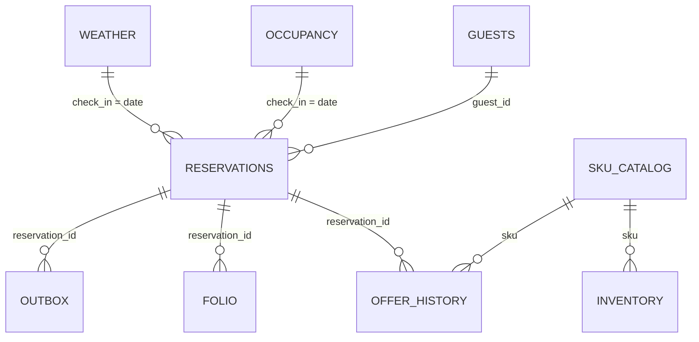

# Data flow and schemas

## Lineage
```
synthetic_generator -> data/raw/*.csv|parquet -> data_validator (47 checks, PSI drift) -> validation/data_validation_report.json
raw/offer_history.parquet -> XGBoost (GPU) -> models/nba_xgb.joblib + evaluation/holdout_predictions.parquet -> model_eval -> evaluation/model_metrics.json
raw/{guests,reservations,inventory}.csv -> SQLite pms.sqlite (live PMS/CRM/RMS stand-in)
data/knowledge_base/*.md -> chunks -> Chroma (dense, fp16 CUDA) + BM25 -> RRF -> rerank
offline_replay -> metrics/metrics.json, metrics/journeys.jsonl, metrics/node_latency.csv, evaluation/judge_results.json
```

## ERD


## Feature definitions (XGBoost, `nba_rms_engine.FEATURES`)
Categorical: `category`, `segment`, `loyalty_tier`, `channel_group`, `room_type`.
Numeric: `adr`, `nights`, `party_size`, `lead_days`, `ltv_usd`, `total_stays`, `ota_ratio` (OTA stays / total stays), `precip_prob`, `temp_c`, `has_event`, `occupancy_pct`, `price` (list), `discount_pct`.
Label: `accepted` in {0,1}. Split: 75/25 stratified, validation carved from train for early stopping.

## Validation rules (full dictionary is generated into README.md)
* Schema columns and dtypes per table; no nulls; numeric ranges (e.g. `precip_prob in [0,1]`, `party_size 1..20`); enums (segment, tier, channel_group, room_type, status).
* Referential: every reservation has a guest; every offer has a reservation; inventory SKUs exist in the catalog; reservation dates are covered by weather.
* Consistency: `check_out > check_in`, `nights == check_out - check_in`, `ota_stays + direct_stays == total_stays`, `booked <= capacity`, `rooms_sold <= rooms_total`, `final_price == price x (1 - discount/100)`.
* Drift: PSI between completed (training) and confirmed (upcoming) reservations on `adr`, `lead_days`, `nights`, `party_size`, threshold 0.25.

## Runtime tables (SQLite)
`folio(reservation_id, sku, qty, amount, service_date, ts)` unique per reservation+SKU - `outbox(thread_id, subject, body, sku, status)` - `hitl_queue(thread_id, reasons, draft, offer, status, decision)` - `audit(action, sku, amount, status, detail)`.

## Synthetic-data caveat
Acceptance labels come from a hidden logistic behaviour model with a per-guest random effect that XGBoost cannot see (so AUC is well below 1). The same model is the "ground truth" in the replay. All revenue results are therefore simulation results.
