# GPU-Accelerated 2-Agent Pre-Arrival Upsell & Margin Guardrail System

A decisioning platform that maximises ancillary hospitality revenue (room upgrades, spa, private dining, late checkout) at **T-7 … T-1 days
before arrival** while blocking room-margin cannibalisation, ADR-floor breaches, inventory stockouts and redundant loyalty-perk discounting.

* **GPU quant core** (PyTorch/CUDA): monotone price-elasticity net, DragonNet + X-Learner uplift, batched LinUCB / Neural Thompson Sampling, convex allocator with shadow prices.
* **Two LangGraph agents** in a bounded Generator-Critic loop (`R_max = 3`) with Human-in-the-Loop interrupt:
  **Agent 1 – Revenue & Personalization Strategist**, **Agent 2 – Yield & Brand Compliance Auditor**.
* **Local LLM**: `qwen3-vl-30b-a3b-instruct` through an OpenAI-compatible endpoint (`http://localhost:8000/v1`), JSON-schema-constrained output, multimodal hook.
* **Offline policy evaluation**: IPS, SNIPS, Doubly Robust, Qini/AUUC, regret — validated against simulator ground truth.
* **Interfaces**: Flask REST + PMS webhook + HITL queue + audit UI, Streamlit dashboard with an **End-to-End Flow** tab (6 stages, 3 flow types, 7 worked examples) and an overall **Flow Metrics** tab, Playwright E2E verification with the screenshots below.
* **Math at every level**: [`docs/MATHEMATICAL_FOUNDATIONS.md`](docs/MATHEMATICAL_FOUNDATIONS.md) (L1–L10) — each module docstring repeats its equations.

> **Honest status.** Everything below was run on an RTX 3090. The Qwen3-VL server was **not running** during the recorded runs, so agents used the
> deterministic fallback path (`llm_mode: fallback`, shown in every trace). The code paths for the live model (structured output, retries, vision) are implemented but only
> exercised when the endpoint is reachable.

---

## 1. Architecture

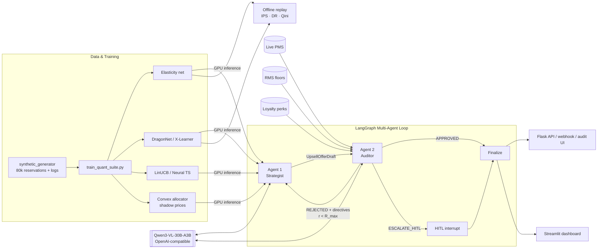

### Generator-Critic state machine

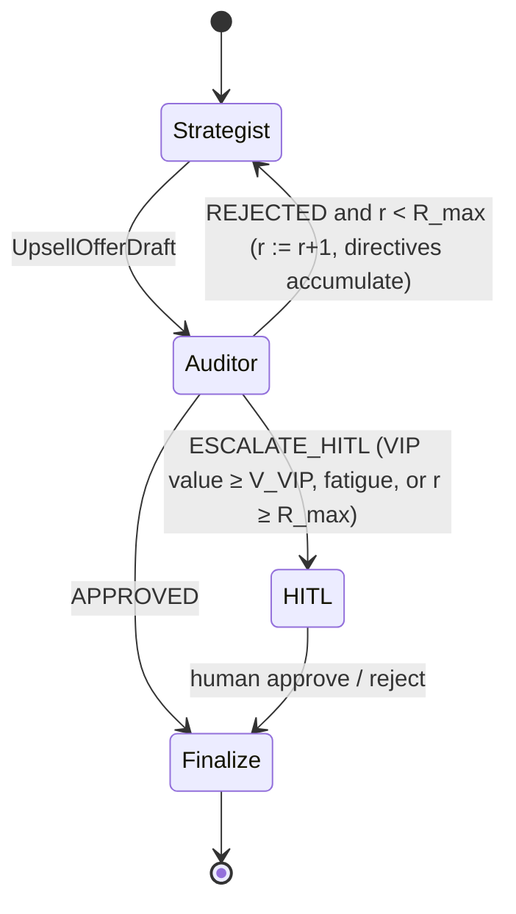

### Directory layout

```text
configs/        config.yaml (CUDA, hyper-parameters, RMS floors, LLM)  ·  brand_policies.yaml (perk matrix, tone rules, HITL thresholds)
data/           synthetic_generator.py
models/         elasticity_net.py  uplift_models.py  contextual_bandit.py  convex_allocator.py  train_quant_suite.py  utils.py
evaluation/     offline_replay.py
agents/         schemas.py  tools.py  llm_client.py  strategist_agent.py  auditor_agent.py  graph.py  flows.py (stage + overall flow metrics)
apps/           flask_api.py  streamlit_app.py
scripts/        verify_and_capture.py
tests/          28 tests (guardrails, math identities, graph loop, schemas)
docs/           MATHEMATICAL_FOUNDATIONS.md
outputs/        checkpoints/  metrics/  plots/  screenshots/  logs/
```

---

## 2. Quick start

```bash
pip install -r requirements.txt            # torch must be a CUDA build
python data/synthetic_generator.py         # 80,000 reservations + PMS/RMS tables + bandit logs
python models/train_quant_suite.py         # trains all GPU models, writes .pt / metrics / 300-DPI plots / GPU telemetry
python evaluation/offline_replay.py        # IPS / SNIPS / DR / Qini / regret
python -m pytest -q                        # 28 tests
python -m agents.flows                     # run all 7 end-to-end flows -> outputs/metrics/flow_metrics.json
python apps/flask_api.py                   # http://127.0.0.1:5055/audit
streamlit run apps/streamlit_app.py --server.port 8505
python scripts/verify_and_capture.py       # boots both apps, checks the API, saves screenshots, exit 1 on failure
```

Serve the model (any OpenAI-compatible server; the code never launches it), e.g.
`vllm serve Qwen/Qwen3-VL-30B-A3B-Instruct --served-model-name qwen3-vl-30b-a3b-instruct --port 8000`
(a 30B MoE needs quantisation or multi-GPU; on a single 24 GB card use a quantised build). `GET /health` reports `llm_mode: qwen | fallback`.

---

## 3. Components, with the mathematics (details in [docs](docs/MATHEMATICAL_FOUNDATIONS.md))

### 3.1 Monotone price-elasticity network — `models/elasticity_net.py`
$$\text{logit}(x,k,p)=g(h)-\sum_j \mathrm{softplus}(v_j(h))\ \mathrm{softplus}\big(s(\ln\tfrac{p}{p^{list}}-\kappa_j)\big)\ \Rightarrow\ \partial\hat P/\partial p<0\ \ \forall x$$

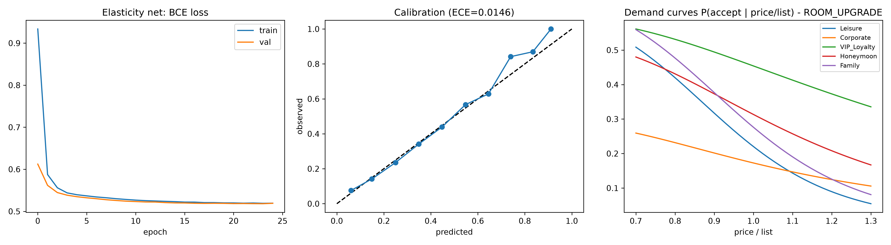

### 3.2 Uplift: DragonNet & X-Learner — `models/uplift_models.py`
$$\hat\tau_X=g\,\hat\tau_0+(1-g)\,\hat\tau_1,\qquad \mathcal L_{Dragon}=\mathrm{BCE}(y,\hat\mu_t)+\alpha\,\mathrm{BCE}(t,\hat e)+\beta\,\|y-\hat\mu_t-\epsilon h\|^2,\ \ h=\tfrac{t}{\hat e}-\tfrac{1-t}{1-\hat e}$$

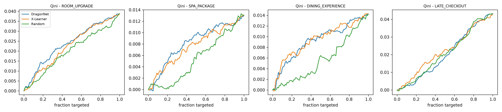

### 3.3 Batched contextual bandits — `models/contextual_bandit.py`
$$a_t=\arg\max_a\ \hat\theta_a^\top x+\alpha\sqrt{x^\top A_a^{-1}x}\ \ (\text{LinUCB}),\qquad \tilde\theta_a\sim\mathcal N(\hat\theta_a,\nu^2A_a^{-1})\ \ (\text{Neural TS})$$

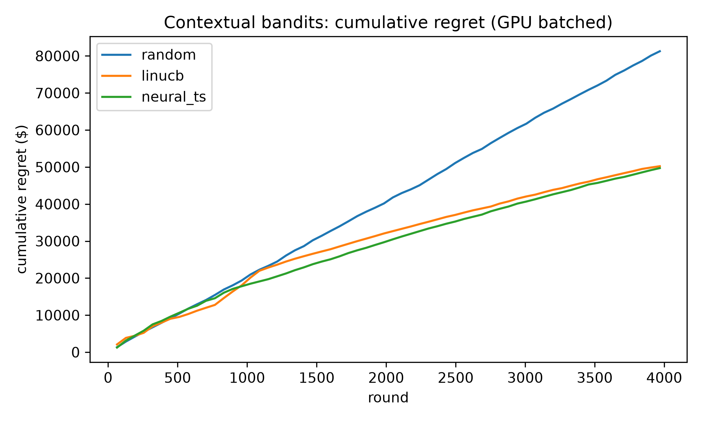

### 3.4 Convex allocator & shadow prices — `models/convex_allocator.py`
$$\max_q\sum q_{ik}P_{ik}m_{ik}+\tau H(q)\ \ \text{s.t.}\ \sum_iq_{ik}P_{ik}\le I_k\ (\lambda_{inv,k}),\ \sum q_{ik}P_{ik}d_{ik}\le B\ (\lambda_B),\qquad h_{ik}=\lambda_{inv,k}+\lambda_Bd_{ik}$$

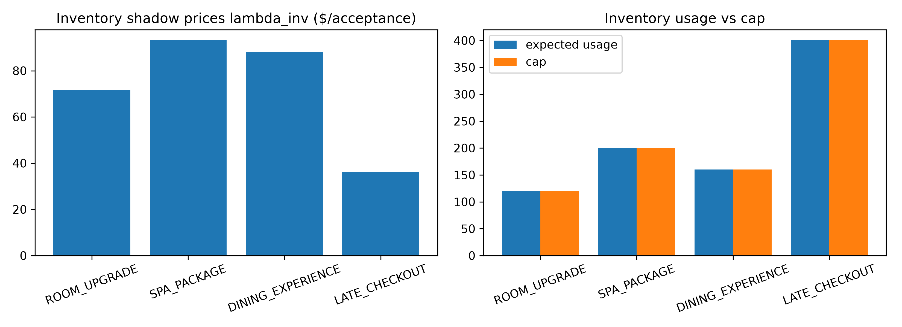

### 3.5 Agent contracts — `agents/`
Agent 1 ranks by $S_k=\hat\tau_k(p_k^*-c_k)+\text{UCB}_k-h_k$ with $p^*=\arg\max_{p\ge\text{floor}}(p-c)\hat P(x,p)$, then asks Qwen for copy only.
Agent 2 enforces deterministic contracts and returns `APPROVED | REJECTED(+codes, directives) | ESCALATE_HITL`:

| Contract | Rule | Code |
|---|---|---|
| PMS buffer | $A_{live}\ge\max(B_{min},\lceil z\sigma_D\sqrt L\rceil)$ | `INVENTORY_BUFFER` |
| ADR / margin floor | $p\ge\text{floor}$, $(p-c)/p\ge0.30$ | `BELOW_RMS_FLOOR`, `MARGIN_BELOW_THRESHOLD` |
| Loyalty parity | $\text{bundle}\cap\text{tier perks}=\varnothing$; SKU not already a free perk | `LOYALTY_PERK_DUPLICATION`, `SKU_ENTITLED_FREE` |
| Brand tone | regex ban-list ∧ Qwen tone score ≥ 0.7 ∧ length | `TONE_BANNED_PHRASE`, `TONE_SCORE_LOW`, `COPY_TOO_LONG` |
| Visual alignment | Qwen3-VL on attached asset | `VISUAL_MISALIGNMENT` |
| HITL | $w_{tier}\,p\ge\$250$ or $r\ge R_{max}$ or contact fatigue | `ESCALATE_HITL` |

Termination: $r$ strictly increases per cycle and the auditor escalates at $r\ge R_{max}$ ⇒ at most $R_{max}+1$ drafts (tested for $R_{max}\in\{0..3\}$).

### 3.6 Offline policy evaluation — `evaluation/offline_replay.py`
$$\hat V_{IPS}=\tfrac1N\sum\min(w_i,M)r_i,\quad \hat V_{DR}=\tfrac1N\sum\big[\hat q^\pi(x_i)+\min(w_i,M)(r_i-\hat q(x_i,a_i))\big],\quad w_i=\tfrac{\pi(a_i|x_i)}{\pi_0(a_i|x_i)}$$

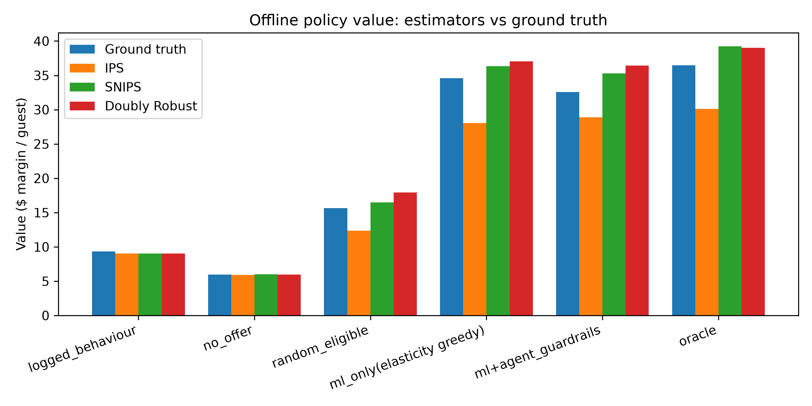

---

## 4. Results (held-out data, seed 42)

**Quant suite** (`outputs/metrics/quant_suite_report.json`)

| Model | Metric | Result |
|---|---|---|
| Elasticity net | val BCE · RMSE vs true P(accept) · ECE · monotonicity violations | 0.518 · 0.039 · 0.0146 · **0** |
| Elasticity net | inference latency (8.5k rows) · peak VRAM | 2 ms · 37 MiB |
| DragonNet √PEHE (ROOM / SPA / DINING / LATE) | vs constant-ATE baseline 0.059 / 0.058 / 0.059 / 0.051 | 0.033 / 0.036 / 0.040 / **0.066** |
| X-Learner √PEHE | | 0.053 / 0.061 / 0.066 / 0.072 |
| Bandits (≈4k rounds) | cumulative regret: random / LinUCB / Neural TS | 81.3k / 50.2k / 49.7k |
| Allocator | KKT primal violation · complementary slackness | 5e-6 · 4.5e-4 |
| Shadow prices λ_inv ($/acceptance) | ROOM / SPA / DINING / LATE ; λ_B | 71.5 / 93.1 / 88.1 / 36.1 ; 1.84 |

**Policy value** ($ margin per guest; ground truth from the simulator; 16k held-out reservations)

| Policy | True | IPS | SNIPS | DR [95 % CI] | Guardrail violations | Cannibalising offers |
|---|---|---|---|---|---|---|
| Logged behaviour | 9.34 | 9.03 | 9.03 | 9.03 [8.55, 9.55] | 14.9 % | 9.4 % |
| No offer | 5.97 | 5.93 | 5.98 | 5.96 | 0 % | 0 % |
| ML only (elasticity-greedy) | 34.58 | 28.05 | 36.33 | 37.03 [32.8, 40.3] | **30.1 %** | 1.2 % |
| **ML + agent guardrails** | **32.55** | 28.87 | 35.31 | 36.41 [32.3, 40.2] | **0 %** | **0 %** |
| Oracle | 36.46 | 30.12 | 39.24 | 39.03 | 41.3 % | 0 % |

Reading: the ML policy is ~3.7× the logged policy's value; enforcing the Auditor's contracts costs ≈ 6 % of expected margin (34.58 → 32.55) and removes every floor/margin/parity violation.
IPS under-estimates because weights are clipped at 50 (documented bias/variance trade); DR is closer but over-estimates slightly because the model-based $\hat q$ ignores cannibalisation.

**Known weaknesses (not hidden).** LATE_CHECKOUT uplift is poor: DragonNet's √PEHE (0.066) is worse than the constant-ATE baseline (0.051) and its Qini is ≈ 0 —
the effect there is driven by tier entitlement that the features capture only weakly. Uplift rankings for the other three categories correlate 0.77–0.86 with the true CATE.
The bandit uses a simulator for rewards, and Qini on observed data has few treated samples per category (~2k).

---

## 5. End-to-end flows, interfaces & verification (Playwright, 29/29 checks)

### 5.1 The six stages and what is measured at each

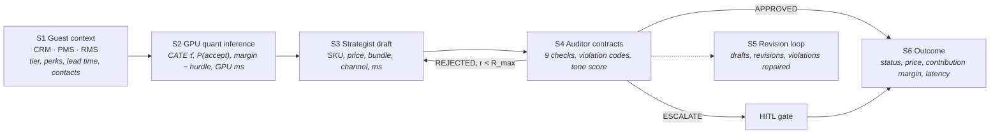

The Streamlit **End-to-End Flow** tab runs any example live and shows one panel per stage (`agents/flows.py::stage_metrics`).
The **Flow Metrics** tab aggregates all examples (`outputs/metrics/flow_metrics.json`, regenerate with `python -m agents.flows`).

### 5.2 Three flow types, each with at least two worked examples

| Flow | Path | Examples |
|---|---|---|
| **Straight-through** | Strategist → Auditor ✔ → Finalize | `clean_approval`, `corporate_late_checkout` |
| **Reject → revise → approve** | Strategist → Auditor ✘ → Strategist (directives) → Auditor ✔ → Finalize | `below_floor_price`, `spammy_copy`, `last_room_upgrade` |
| **HITL escalation** | … → Auditor ESCALATE → HITL gate → Finalize | `vip_duplicate_perk`, `unresolvable_escalation` |

Per-example metrics at each stage (recorded run, `llm_mode: fallback`, RTX 3090):

| Example | S1 tier | S2 GPU ms · top-candidate CATE | S3 drafts (SKU @ $) | S4 audit sequence (checks passed /9) | S5 revisions | S6 outcome · price · CM | Total ms |
|---|---|---|---|---|---|---|---|
| **clean_approval** | Gold | 95 · +0.238 | ROOM_UPGRADE @ 135 | ✔ (9/9) | 0 | APPROVED · $135 · 63 % | 97 |
| **corporate_late_checkout** | None | 96 · +0.352 | LATE_CHECKOUT @ 59 | ✔ (9/9) | 0 | APPROVED · $59 · 71 % | 98 |
| **below_floor_price** | None | 91 · +0.158 | SPA @ 108 → SPA @ 151 | ✘ `BELOW_RMS_FLOOR` (8/9) → ✔ | 1 | APPROVED · $151 · 60 % | 189 |
| **spammy_copy** | Silver | 98 · +0.257 | LATE_CHECKOUT @ 40.5 ×2 | ✘ `TONE_BANNED_PHRASE`, tone 0.0 (7/9) → ✔ tone 1.0 | 1 | APPROVED · $41 · 58 % | 195 |
| **last_room_upgrade** | Silver | 119 · +0.115 | ROOM_UPGRADE @ 124 → SPA @ 183 | ✘ `INVENTORY_BUFFER` (8/9) → ✔ | 1 | APPROVED · $183 · 67 % | 220 |
| **vip_duplicate_perk** | Diamond | 93 · +0.252 | LATE_CHECKOUT @ 70 → ROOM_UPGRADE @ 188 → SPA @ 281 | ✘ `LOYALTY_PERK_DUPLICATION`+`SKU_ENTITLED_FREE` (7/9) → ✘ `SKU_ENTITLED_FREE` → ESCALATE (VIP value $844 ≥ $250) | 2 | HITL_PENDING · $281 · 79 % | 287 |
| **unresolvable_escalation** | None | 95 · +0.158 | LATE_CHECKOUT @ 38 ×4 | ✘ `TONE_BANNED_PHRASE` ×3 → ESCALATE at R_max | 3 | HITL_PENDING · $38 · 56 % | 383 |

S2's "top candidate" is the highest-scoring SKU whose unit margin clears the shadow-price hurdle; the stress hooks in `reject → revise` examples deliberately steer the *draft* to a different SKU (e.g. `prefer_sku`).
Click-through screenshots (one per example, all six stages visible):

| Straight-through | | |
|---|---|---|
| 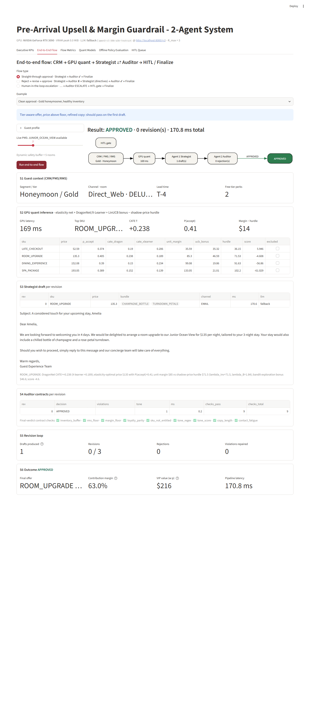 | 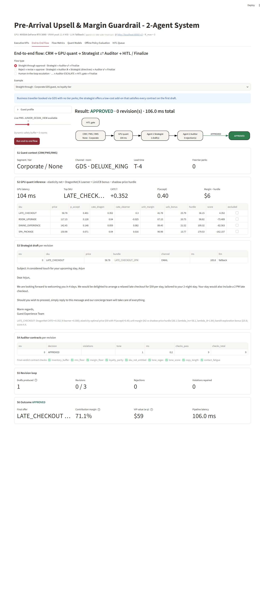 | |

| Reject → revise → approve | | |
|---|---|---|
| 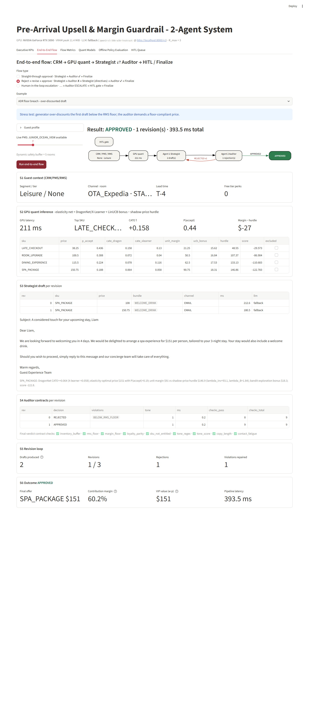 | 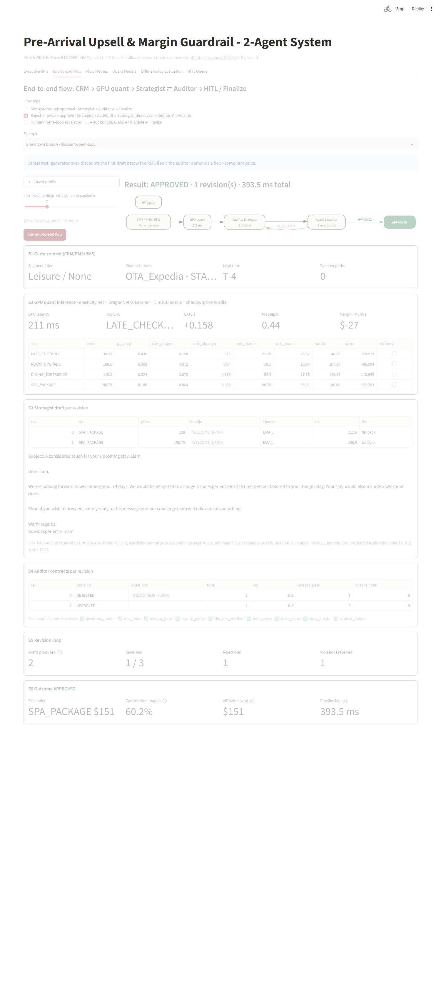 | 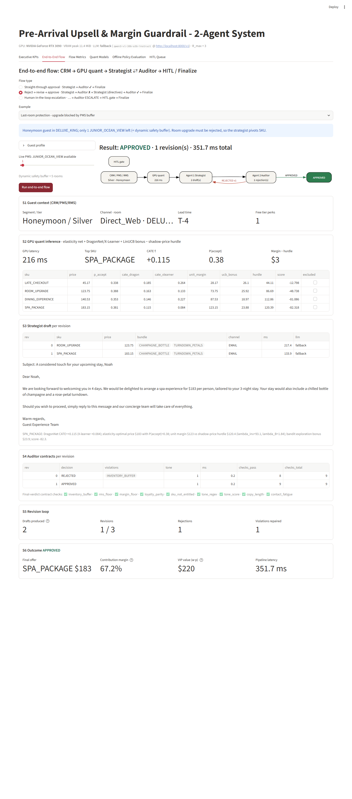 |

| HITL escalation | |
|---|---|
| 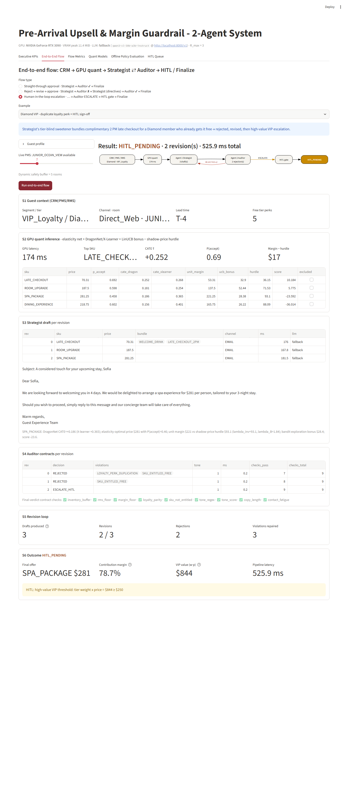 | 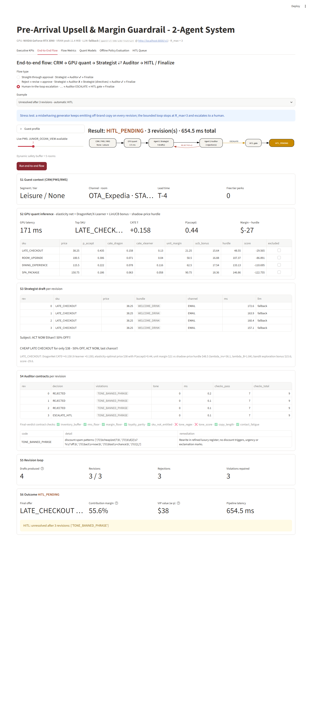 |

### 5.3 Overall metrics across all flows (7 runs)

| Metric | Value |
|---|---|
| First-draft approval (no revision) | 2 / 7 = **29 %** |
| Final auto-approval · HITL escalation | **71 %** · **29 %** |
| First drafts rejected by the Auditor | 5 / 7 = 71 % |
| Violations caught (10 total) | `TONE_BANNED_PHRASE` 5 · `SKU_ENTITLED_FREE` 2 · `LOYALTY_PERK_DUPLICATION` 1 · `INVENTORY_BUFFER` 1 · `BELOW_RMS_FLOOR` 1 |
| Mean revisions · max seen (bound R_max = 3) | 1.14 · 3 |
| Latency p50 / p95 / max (full pipeline) | 195 / 354 / 383 ms |
| Mean GPU quant inference | 98 ms |
| Mean latency by flow | straight-through 97 ms · reject→revise 201 ms · HITL 335 ms |
| Mean contribution margin of final offers (floor 30 %) | 65 % |

**Read these correctly.** Five of the seven scenarios inject a deliberately faulty first draft, so the 29 % first-pass rate and 71 % rejection rate measure whether the Auditor
*catches planted faults*, not how often a production strategist errs. The meaningful results are: every planted fault was caught with the right code, every repairable one was fixed within one or two
revisions, nothing unresolvable escaped the `R_max` bound, and no final auto-approved offer violates a contract. Seven runs is a smoke-level sample; for population-level behaviour use §4 (OPE over 16k reservations).
Latencies are with the template fallback; a live 30B model will dominate them.

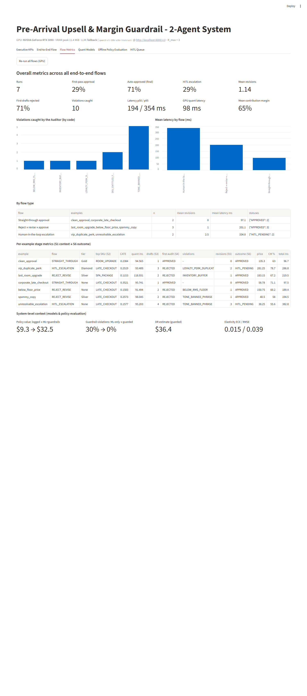

### 5.4 Other dashboard tabs and the Flask UI

**Executive KPIs** (model + policy metrics) · **Quant Models** · **Offline Policy Evaluation** · **HITL Queue**
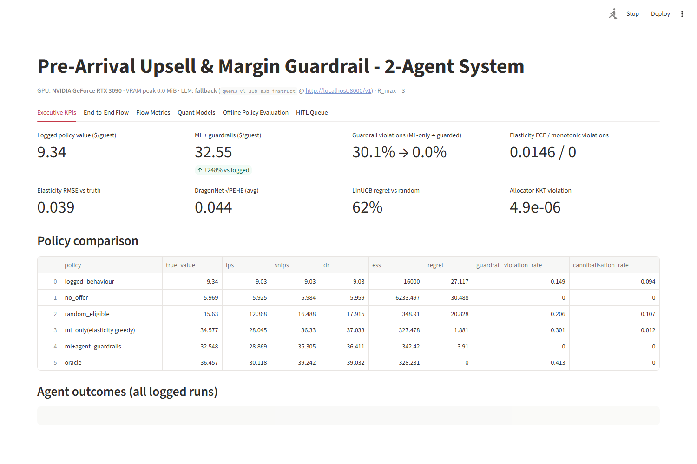

| Quant models | Offline policy evaluation | HITL queue |
|---|---|---|
| 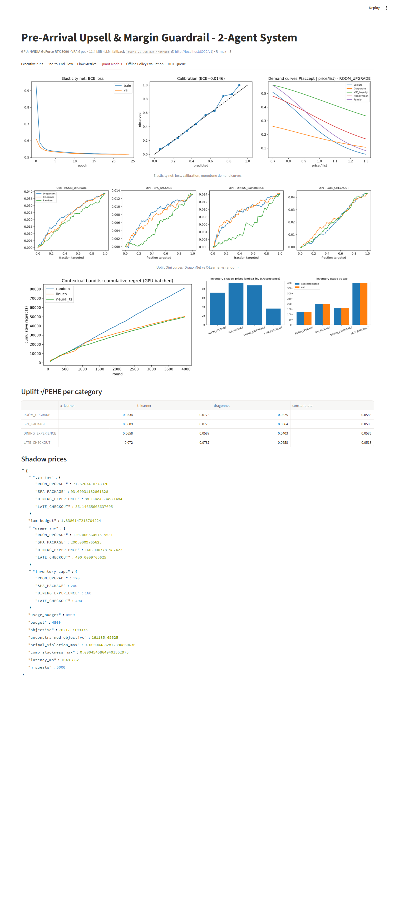 | 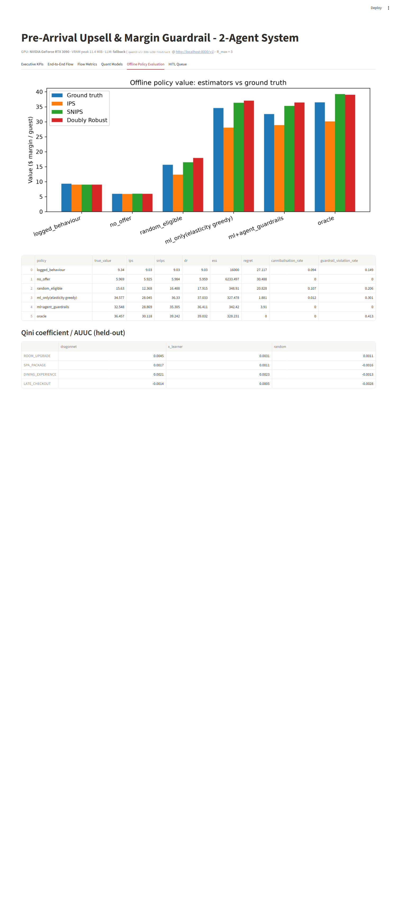 | 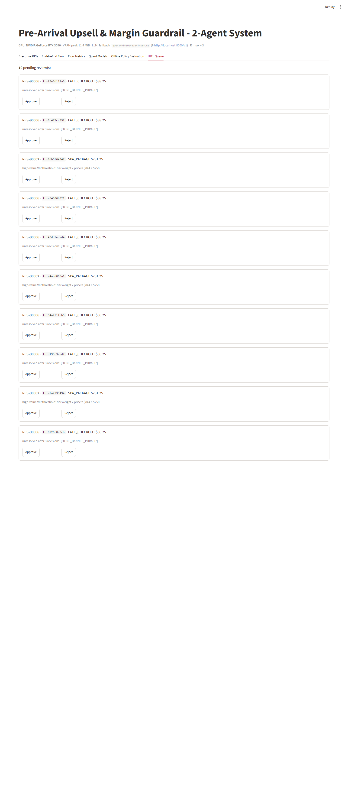 |

**Flask operational audit UI** (run an offer, HITL queue, webhook-fed PMS, runs + agent trace)
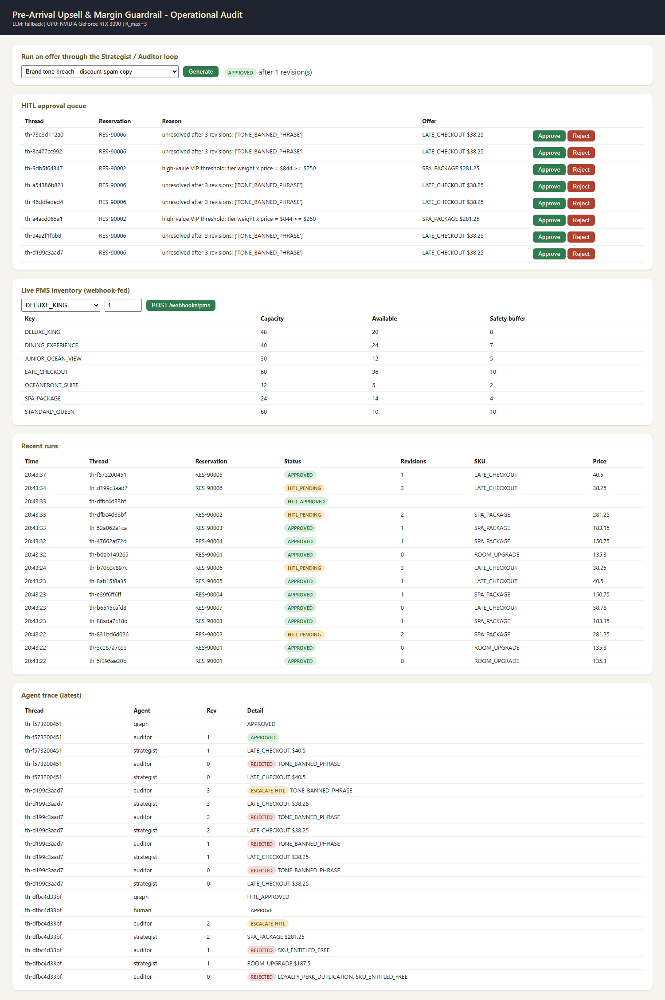

REST API captures: [`/health`](outputs/screenshots/api_health.png) · [`/api/v1/scenarios`](outputs/screenshots/api_scenarios.png) · [`/api/v1/pms`](outputs/screenshots/api_pms.png)

`python scripts/verify_and_capture.py` boots Flask + Streamlit, exercises `/health`, scenario generation, the PMS webhook, the HITL queue (approve → resume), an unresolvable run that escalates at `R_max`,
a malformed webhook (HTTP 400), then drives the Streamlit tabs through all seven examples and saves every screenshot above (exit code 1 on any failure).
The reject→revise and HITL scenarios (all but the two straight-through ones) use explicit **stress-injection hooks** (`injections` in `agents/tools.py::SCENARIOS`); they exercise the critic and are not natural model failures.

### REST API

| Method | Path | Purpose |
|---|---|---|
| GET | `/health` | status, GPU, LLM mode |
| POST | `/api/v1/offers/generate` | `{"scenario": …}` or `{"reservation_id": "RES-00042"}` |
| POST | `/webhooks/pms` | `{"key": "JUNIOR_OCEAN_VIEW", "available": 1}` live inventory push |
| GET | `/api/v1/hitl/queue` · POST `/api/v1/hitl/<thread>/decision` | human review |
| GET | `/api/v1/audit/log` · `/audit` | JSONL-backed audit data and UI |

---

## 6. Outputs & observability

* `outputs/checkpoints/` — `elasticity_net.pt`, `uplift_models.pt`, `linucb.pt`, `graph.sqlite` (LangGraph HITL checkpoints)
* `outputs/metrics/` — `quant_suite_report.json`, `ope_report.json`, `shadow_prices.json`, `data_summary.json`, `verification_report.json`
* `outputs/logs/` — `gpu_telemetry.jsonl` (device, VRAM, latency ms, throughput), `agent_trace.jsonl`, `offer_runs.jsonl`, `hitl_queue.json`
* `outputs/plots/` — 300-DPI figures used above

## 7. Design notes & limitations

* All data is **synthetic**; ground-truth CATE/elasticity make evaluation verifiable but do not imply real-world lift.
* Prices, SKUs and numbers are never chosen by the LLM; it writes copy and judges tone. Copy that omits the tool-supplied price is rejected and regenerated from the template.
* `cvxpy` is not required: the allocator is a PyTorch projected dual-gradient solver (entropy-smoothed, so the dual is smooth).
* The vectorised OPE guardrail filter and the Auditor's deterministic contracts are checked against each other in `tests/test_models_math.py`.
