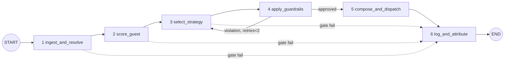

# Architecture & Data Flow

## 1. Data lifecycle

```mermaid
flowchart LR
  W[Raw PMS/OTA webhook] --> D1{{Gate D1<br/>schema + integrity}}
  D1 --> IR[Identity resolution<br/>email -> FAISS block -> CUDA cosine + Jaro-Winkler]
  IR --> D2{{Gate D2<br/>recall>90%, FP<2%}}
  D2 --> FS[Feature store<br/>19 features]
  FS --> ML[XGBoost uplift tau + cancel P]
  ML --> D3{{Gate D3<br/>Qini>0, AUC>=0.72}}
  D3 --> G[LangGraph 6 nodes<br/>pre/post gate per node]
  G --> PE[Policy engine<br/>R1..R6]
  PE --> DSP[Dispatch / suppress holdout]
  DSP --> AT[Attribution loop<br/>treated vs 15% ghost holdout]
```



| Stage | Module | Output |
|---|---|---|
| Generate | `data/synthetic_generator.py` | `data/generated/pms_bookings.csv`, `cdp_profiles.csv` |
| Gate D1 | `data/schema_validator.py` | `outputs/validation/data_validation.json` (key `D1`) |
| Resolve | `models/identity_resolution.py` | `data/generated/resolved_bookings.csv`, `outputs/models/cdp_faiss.index` |
| Features | `models/uplift_pipeline.build_features` | `data/generated/scored_features.csv` |
| Train + Gate D3 | `models/train_and_evaluate.py` | `outputs/models/*`, `outputs/metrics/*`, `outputs/logs/hardware_telemetry.json` |
| Agent | `agent/graph.py` | `outputs/logs/*.jsonl`, `outputs/validation/step_gates.json` |
| Replay | `evaluation/offline_replay.py` | `outputs/evaluation/offline_replay_roi.json`, charts |

## 2. Identity resolution

1. **Deterministic**: the booking's e-mail equals a CDP e-mail (only ~15% of OTA bookings expose a real address; the rest are relay-masked).
2. **Blocking**: hashed char-trigram embedding (512-d, last name weighted 2x, nickname-normalised first name) -> `faiss.IndexFlatIP`, top-20 candidates. FAISS runs on GPU only when a `faiss-gpu` build is installed; the pip `faiss-cpu` wheel used here is CPU.
3. **Rerank (CUDA)**: candidate cosine similarity is a batched torch tensor op on the GPU; Jaro-Winkler is evaluated in pure Python on the few surviving candidates (it is *not* GPU-vectorised).
4. **Accept** only if: phone-last-4 matches (when present), `JW(last) >= .88`, `first_sim >= .80`. With no phone, accept only an exact surname + country + near-exact first name **and** a clear score gap to the runner-up.

Gate D2 definitions: `recall = correct merges / bookings with a true CDP link`; `FP merge rate = wrong merges / all merges` (a merge is wrong if the true link is absent or a different profile).
Measured (20 000 bookings, 6 000 profiles): recall **91.7%**, FP merge **0.25%**, overall match rate 53.6% (58.3% of guests truly exist in the CDP).

Guests with no match get a `SHADOW-<booking_id>` profile so the pipeline continues; they are treated as *unknown consent* (see R5).

## 3. Causal & economic math

Potential outcomes: `Y(1)` = guest books direct within 12 months if intervened on, `Y(0)` otherwise.

**CATE**  `tau(x) = E[Y(1) - Y(0) | X = x]`

* **T-learner**: `tau_T(x) = mu1(x) - mu0(x)`, with `mu_t` XGBoost classifiers fit on each arm.
* **X-learner**: impute `D1 = Y1 - mu0(X1)`, `D0 = mu1(X0) - Y0`; fit `tau1(x)`, `tau0(x)` regressors; `tau_X(x) = g*tau0(x) + (1-g)*tau1(x)` with `g = P(treated) = 0.85`.
* The model with the higher **Qini coefficient** on the held-out test split is promoted. (T and X tied to within 0.00002 in the last run; T was selected. X had the higher correlation with the synthetic oracle tau, 0.54 vs 0.37, but Qini is the gate metric.)

**Qini**: rank by predicted `tau`; `Q(k) = sum_{i<=k} y_i t_i - (N_T(k)/N_C(k)) * sum_{i<=k} y_i (1-t_i)`; coefficient = area between the curve and the random-targeting line, normalised by N.

**Saved commission**  `SC = ADR * LOS * commission_rate`.

**Expected Net Revenue Delta** for an offer with incentive cost `c` (paid only by guests who convert):

```
ENRD = (1 - P_cancel) * [ tau * SC  -  (p0 + tau) * c ]       p0 = 0.12 (catalog: base_conversion_rate)
```

`NO_OFFER` is worth exactly 0. An offer with `ENRD <= 0` is blocked (R4).

## 4. LangGraph state machine

Six nodes, each wrapped by a **pre-condition gate** and a **post-condition gate** (12 gate results per clean run, logged to `outputs/validation/step_gates.json` and `step_gates.jsonl`).



| Node | Pre-condition | Post-condition |
|---|---|---|
| 1 `ingest_and_resolve` | payload validates against `BookingWebhookSchema` (commission .10-.30, ADR>0, LOS>=1 ...) | resolution attempted; profile id present (real or shadow); `saved_commission_usd > 0`; holdout flag set |
| 2 `score_guest` | all 19 features present | zero NaNs; `tau in [-1,1]`; `P_cancel in [0,1]`; inference latency < 1 s (device recorded) |
| 3 `select_strategy` | scores present; window valid | `OfferStrategySchema` valid; `offer_id` in `offer_catalog.yaml`; window matches; non-empty copy. LLM malformed output is retried up to 2x, then the deterministic fallback is used |
| 4 `apply_guardrails` | strategy present | verdict present; approved or retrying; retries <= 2 |
| 5 `compose_and_dispatch` | final offer set and approved | dispatch recorded; **holdout never `sent`**; gated link HMAC-valid |
| 6 `log_and_attribute` | run id present | attribution record written with treatment flag |

**Retry loop**: a blocked proposal is added to `rejected_offers` and the graph returns to node 3 (max 2 times). After that, `best_compliant_offer` deterministically picks the highest-ENRD compliant offer or `NO_OFFER`, and a one-sentence reason is generated (LLM with template fallback). Every evaluation is appended to `guardrail_audits.jsonl`.

**Short-circuit**: any failed gate sets `state.error` and routes to node 6, so nothing is dispatched and the failure is still logged/attributed.

## 5. Policy engine (deterministic; the LLM never decides compliance)

| Rule | Check |
|---|---|
| R1 OTA rate parity | offer is not a public rate cut **and** hotel direct rate >= OTA rate (tolerance from catalog) |
| R2 Margin floor | `(0.60*stay_revenue - cost) / stay_revenue >= 0.35` |
| R3 Incentive ceiling | `cost <= 0.60 * saved_commission` |
| R4 Positive ENRD | `ENRD > 0` |
| R5 Fatigue & consent | `msgs_30d < 3` and consent: resolved guests need `email_opt_in`; **guests with no CDP match (unknown consent) are only eligible in the `on_property` window**, where the Wi-Fi portal captures opt-in |
| R6 Window fit | offer window equals the active window or `any` |

R5's treatment of unmatched guests is a deliberate conservative default. It cuts the targeted share substantially (see README results) and is a business/legal decision you may want to relax per market.

## 6. Data dictionaries

**`pms_bookings.csv`**: `booking_id` PK; `ota` {Expedia, Booking.com, Agoda}; `masked_email`; `email_is_real`; `first_name`, `last_name` (OTA-noised); `phone_last4` (nullable); `country`; `checkin_date`; `los`; `adr`; `ota_commission`; `lead_days`; `trip_purpose`; `free_cancellation`; `is_ghost_holdout`; `treated`; `converted_direct` (outcome); `cancelled` (outcome); `saved_commission_usd`; **generator-only truth** (never fed to models): `true_profile_id`, `true_tau`.

**`cdp_profiles.csv`**: `profile_id` PK; `first_name`, `last_name`, `email`, `phone`, `country`; `loyalty_tier` {none, member, silver, gold}; `past_direct_stays`; `past_ota_stays`; `lifetime_value_usd`; `email_opt_in`; `msgs_30d`.

**`outputs/logs/agent_decisions.jsonl`**: `run_id, ts, booking_id, profile_id, ota, window, treatment, ghost_holdout, offer_id, tau, p_cancel, saved_commission_usd, expected_net_revenue_delta, downgraded, llm_mode, error, strategy{}, guardrail{}, trace[]`.

**`guardrail_audits.jsonl`**: `run_id, ts, booking_id, proposed_offer, verdict{approved, rule_results[], enrd, margin_pct, blocking_rules[]}, retry` plus `downgraded_to, reason, final_verdict` on a downgrade.

**`step_gates.jsonl`**: `run_id, gates[{node, phase, passed, checks[{check, passed, detail}], ms}]`.

**`outbox.jsonl`**: `ts, booking_id, channel, status {sent | suppressed_ghost_holdout}, link, copy`.

**`hardware_telemetry.json`**: GPU name, CUDA version, VRAM, XGBoost device, FAISS backend, training timings. **`latency_gpu.json`**: CPU-vs-GPU single/batch inference, training times, identity-resolution timings.

## 7. Known limitations

* All data is **synthetic**; absolute ROI is a property of the generator, not of any real hotel. The pipeline mechanics (gates, causal estimators, guardrails) are what is being demonstrated.
* At this scale (20 k rows) the **GPU is not faster**: X-learner training took ~1.0 s on CUDA vs ~0.4 s on CPU, and single-row inference is ~2-3 ms on both. GPU benefits would appear at much larger data/model sizes.
* Decile-level agreement between predicted and measured uplift is moderate (Spearman ~0.37 on the test replay); the model ranks better than random (Qini > 0) but is far from the oracle.
* The "blast to all" replay baseline ignores consent and guardrails and is therefore **not a compliant alternative**; it is shown only as an upper reference.
