# Autonomous OTA-to-Direct Conversion Agent

An end-to-end, locally runnable agent that turns OTA reservations (Expedia, Booking.com, Agoda) into direct-booking relationships:

1. ingests OTA reservation webhooks and validates them (**Gate D1**),
2. resolves masked guests against a CDP (FAISS blocking + CUDA similarity, **Gate D2**),
3. trains XGBoost **uplift** (T/X-learner) and **cancellation-risk** models on the GPU and blocks promotion on poor quality (**Gate D3**),
4. runs a **6-node LangGraph** state machine with a pre- and post-condition validation gate on every node,
5. proposes offers and copy with a local **`qwen3-vl-30b-a3b-instruct`** (strict Pydantic JSON, offline fallback) while **deterministic guardrails** (OTA rate parity, margin floor, fatigue/consent) make every compliance decision,
6. keeps a randomised **15% ghost holdout** that is never messaged, so lift is measured causally,
7. serves a **Flask** REST API + web UI and a **Streamlit** dashboard, and produces validation reports, metrics, diagrams and VLM-audited charts under `outputs/`.

> All data is synthetic. Numbers describe how the pipeline behaves on that generator (seed 42, 20 000 bookings), not a real property. Math, schemas and limitations: [ARCHITECTURE_AND_DATA_FLOW.md](ARCHITECTURE_AND_DATA_FLOW.md).

**Contents:** [Architecture](#architecture) · [Setup & run](#setup) · [Step-by-step approach](#step-by-step-approach-with-flow) · [Metrics per stage](#metrics-per-stage) · [Performance metrics](#performance-metrics) · [Five end-to-end flows](#five-end-to-end-flows) · [Streamlit story](#the-streamlit-end-to-end-story) · [Results & caveats](#results--caveats) · [API](#rest-api-flask) · [Layout](#layout)

## Architecture

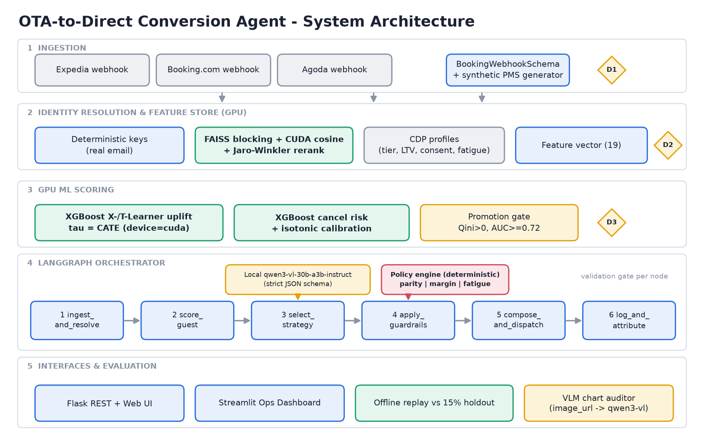

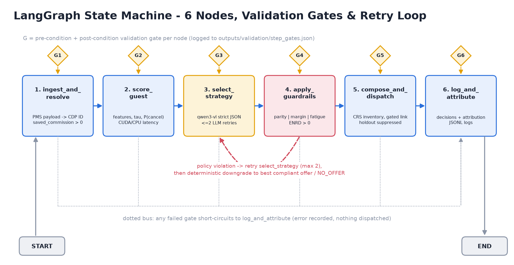

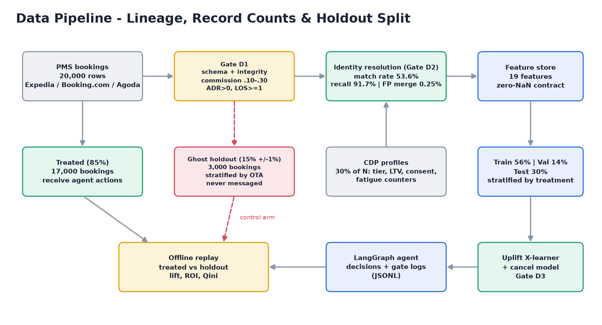

## Setup

```powershell
# Python 3.11. Install CUDA torch first (adjust to your CUDA):
pip install torch --index-url https://download.pytorch.org/whl/cu128
pip install -r requirements.txt
python -m playwright install chromium        # only for screenshots
```

### Local LLM (`qwen3-vl-30b-a3b-instruct`)

Start any OpenAI-compatible server hosting the model (LM Studio, vLLM, Ollama ...). The app probes, in order, `LLM_BASE_URL` (if set), `http://localhost:1234/v1`, `:8000/v1`, `:11434/v1` via `GET /models` and picks the model id containing `LLM_MODEL_NAME`.

| Env var | Default | Meaning |
|---|---|---|
| `LLM_BASE_URL` | auto-discover | force an endpoint |
| `LLM_MODEL_NAME` | `qwen3-vl-30b-a3b-instruct` | model id to match |
| `FORCE_OFFLINE_LLM` | `false` | skip the LLM; use deterministic fallback |
| `FORCE_CPU` | `false` | ignore CUDA |
| `OUTPUT_DIR` | `outputs/` | redirect all artifacts (used by tests) |

If the endpoint is unreachable (and always under pytest) the agent uses a **deterministic offline fallback** (highest-ENRD catalog offer + templated copy). `llm_mode` in every decision record says `live` or `offline_fallback`. The VLM chart auditor falls back to a pixel heuristic labelled `offline_heuristic` (not a visual-language judgement).

### CUDA notes

* XGBoost: `tree_method="hist"`, `device="cuda"` when `torch.cuda.is_available()` else `cpu`.
* Identity resolution: candidate cosine similarity runs as CUDA tensors. FAISS uses the GPU only with a `faiss-gpu` build (typically Linux); the pip wheel here is `faiss-cpu` (reported as `faiss_backend`). Jaro-Winkler is pure Python on shortlisted candidates.
* **At this data size the GPU is not faster** — see [latency](#latency-cpu-vs-gpu).

## Run

```powershell
python evaluation/verify_e2e.py                 # everything: data -> gates -> train -> replay -> diagrams -> VLM audit -> pytest -> UIs -> screenshots
python evaluation/verify_e2e.py --skip-ui       # no browsers/servers

python data/synthetic_generator.py              # data/generated/*.csv
python models/train_and_evaluate.py             # gates D1-D3, models, metrics, hardware telemetry
python evaluation/offline_replay.py             # treated vs holdout lift/ROI + Qini/waterfall/lift charts
python evaluation/diagram_generator.py          # 3 diagrams
python evaluation/vlm_chart_auditor.py          # outputs/evaluation/vlm_visual_audit.json
python -m web_flask.app                         # http://127.0.0.1:5055   (REST + UI)
python -m streamlit run ui_streamlit/dashboard.py --server.port 8511
python -m pytest -q                             # 40 tests, LLM forced offline
```

---

## Step-by-step approach with flow

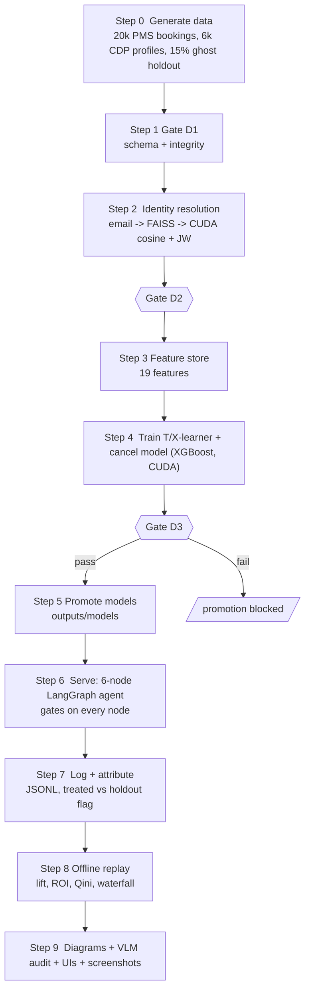

| Step | What happens | Module | Gate / check | Output |
|---|---|---|---|---|
| 0 | Synthetic OTA bookings (OTA-noised names, masked e-mails, last-4 phone), CDP profiles, ground-truth links, outcomes from a known heterogeneous uplift. Holdout: exactly 15% per OTA, random | `data/synthetic_generator.py` | - | `data/generated/*.csv` |
| 1 | Schema, dtypes, unique non-null PK, commission .10-.30, ADR>0, LOS>=1, holdout 15%±1% overall **and per OTA** | `data/schema_validator.py` | **D1** | `validation/data_validation.json` |
| 2 | (a) real-e-mail exact match; (b) FAISS top-20 on hashed char-trigram name embeddings; (c) CUDA cosine + Jaro-Winkler + phone-last-4 + country; (d) conservative acceptance rules | `models/identity_resolution.py` | **D2** recall>90%, FP<2% | `resolved_bookings.csv`, FAISS index |
| 3 | Join CDP attributes; 19 numeric features; unmatched guests get zeros + `is_resolved=0` | `models/uplift_pipeline.build_features` | zero-NaN contract | `scored_features.csv` |
| 4 | Stratified train/val/test (56/14/30). T- and X-learner (XGBoost, `device=cuda`); cancel classifier + isotonic calibration on val | `models/train_and_evaluate.py` | **D3** Qini>0, AUC>=0.72 | metrics CSV/JSON |
| 5 | Save models only if D3 passed (`promotion.json`) | same | promotion gate | `outputs/models/*` |
| 6 | For each webhook run the 6 nodes (below), each wrapped in pre/post gates | `agent/graph.py`, `validators.py` | 12 gate results per clean run | state + `step_gates.json` |
| 7 | Append decision, guardrail audit, gate log, outbox record | `agent/tools.py` | attribution has treatment flag | `outputs/logs/*.jsonl` |
| 8 | On the held-out test split, apply the policy offline; compare treated vs ghost-holdout among targeted guests (bootstrap CI) | `evaluation/offline_replay.py` | - | `evaluation/offline_replay_roi.json` |
| 9 | Render diagrams, send every chart to the VLM, run tests, start both UIs, capture screenshots | `evaluation/verify_e2e.py` | e2e report | `charts/`, `screenshots/` |

### The six agent nodes (detail)

| # | Node | Does | Pre-condition | Post-condition | Failure behaviour |
|---|---|---|---|---|---|
| 1 | `ingest_and_resolve` | validates payload, resolves identity (shadow profile if no match), computes saved commission, sets holdout flag (dataset flag or SHA-256 hash 15%) | `BookingWebhookSchema` valid | resolution attempted; profile id; `saved_commission_usd>0`; holdout flag | short-circuit to node 6 |
| 2 | `score_guest` | builds 19 features, scores tau and P(cancel) | feature vector complete | zero NaN; tau∈[-1,1]; P∈[0,1]; latency<1 s | short-circuit |
| 3 | `select_strategy` | local LLM picks `offer_id` + channel + personalised copy (strict JSON); malformed output retried ≤2×, then fallback | scores present | schema valid; offer in catalog; window match; non-empty copy | short-circuit |
| 4 | `apply_guardrails` | rules R1-R6; blocked offer → retry node 3 (≤2×) → deterministic downgrade with a reason | strategy present | verdict present; approved or retrying; retries≤2 | bounded loop |
| 5 | `compose_and_dispatch` | CRS inventory check (upgrade may be swapped), HMAC-signed gated link, dispatch or suppress holdout | final offer approved | **holdout never `sent`**; link signature valid | short-circuit |
| 6 | `log_and_attribute` | writes attribution (`treatment`, `ghost_holdout`, offer, tau, ENRD) | run id | attribution written | always runs |

Guardrails: **R1** OTA parity · **R2** margin floor 35% · **R3** incentive ≤ 60% of saved commission · **R4** ENRD > 0 · **R5** fatigue cap 3/30d + consent (guests with no CDP match are only eligible in the `on_property` window) · **R6** window fit. The LLM proposes; only `agent/policy_engine.py` decides compliance.

---

## Metrics per stage

### Data & model stages (latest run)

| Stage | Metric | Value | Threshold | Result |
|---|---|---|---|---|
| D1 ingestion | rows / dupes / nulls | 20 000 / 0 / 0 | unique, non-null | pass |
| D1 | commission range | 0.100 – 0.300 | .10–.30 | pass |
| D1 | holdout share (overall; each OTA) | 15.0%; 15.0 / 15.0 / 15.0% | 15% ±1% | pass |
| D2 identity | recall (11 663 truly linked) | **91.7%** | >90% | pass |
| D2 | false-positive merge rate (27 wrong of 10 719 merges) | **0.25%** | <2% | pass |
| D2 | match methods | 8 794 fuzzy name+phone4 · 1 724 deterministic e-mail · 201 name-only-unique · 9 281 unmatched | - | match rate 53.6% |
| D3 uplift | Qini coefficient (T / X-learner) | 0.00498 / 0.00496 | >0 | pass; T-learner promoted (tie) |
| D3 uplift | correlation with synthetic oracle tau (T / X) | 0.37 / 0.54 | informational | X ranks tau better but Qini decides |
| D3 cancel | ROC-AUC | **0.787** | ≥0.72 | pass |
| D3 cancel | Brier / ECE raw → isotonic | 0.144 / 0.015 → 0.020 | informational | calibration already good; isotonic not an improvement in ECE |

Cancel calibration (test, 10 equal-size bins): predicted → observed = 0.02→0.04, 0.04→0.05, 0.09→0.07, 0.12→0.13, 0.16→0.15, 0.23→0.21, 0.26→0.27, 0.30→0.34, 0.41→0.46, 0.64→0.66.

### Agent node metrics (measured over the five flows, live LLM)

Latency per node in milliseconds (from `trace`; first call in a process includes model/index warm-up).

| Node | happy | parity | holdout | wifi | post-stay | Notes |
|---|---|---|---|---|---|---|
| 1 `ingest_and_resolve` | 1 636* | 7.5 | 8.7 | 7.0 | 7.2 | *cold start (FAISS index + CDP load); ~7–9 ms warm |
| 2 `score_guest` | 197* | 13.7 | 17.6 | 12.6 | 15.1 | *XGBoost/CUDA warm-up; ~13–18 ms warm |
| 3 `select_strategy` | 6 012 | 11 353 (3 LLM calls) | 3 910 | 4 175 | 4 332 | **LLM-bound**: ~4–6 s per call on the 30B VLM |
| 4 `apply_guardrails` | 0.4 | 2 822 | 0.4 | 0.4 | 0.4 | deterministic rules <1 ms; 2.8 s only when the LLM writes the downgrade reason |
| 5 `compose_and_dispatch` | 0.3 | 0.1 | 0.4 | 0.3 | 0.3 | |
| 6 `log_and_attribute` | 0.3 | 0.4 | 0.3 | 0.3 | 0.2 | |

Gate outcomes: every clean run produces **12 gate results (6 nodes × pre/post), all PASS**; the parity flow produces 20 (retry loop re-runs nodes 3–4). Per-node pass/fail counters accumulate in `outputs/validation/step_gates.json`.

**Take-away:** end-to-end latency is ~4–6 s with the live LLM (≈ 25 ms without it); everything the agent does deterministically costs under 50 ms.

---

## Performance metrics

### Business replay (test split, targeted guests only)

| Metric | Value |
|---|---|
| Test bookings / targeted by policy | 6 000 / 1 561 (**26%**) |
| Treated vs ghost-holdout (targeted) | 1 329 vs 232 |
| Direct-rebook rate: treated vs holdout | 39.1% vs 24.6% |
| **Incremental lift** | **+14.5 pts** (95% bootstrap CI 9.4 – 20.1) |
| Incremental direct bookings | ≈ 193 |
| Avg saved commission per conversion | $90.32 |
| Gross saved commission | $17 384 |
| − cancellation leakage | −$3 684 |
| − incentive cost | −$6 228 |
| **Net revenue delta** | **$7 472** |
| ROI on incentive spend | 1.2× |
| Unconstrained "blast everyone" net (not compliant) | $18 386 |

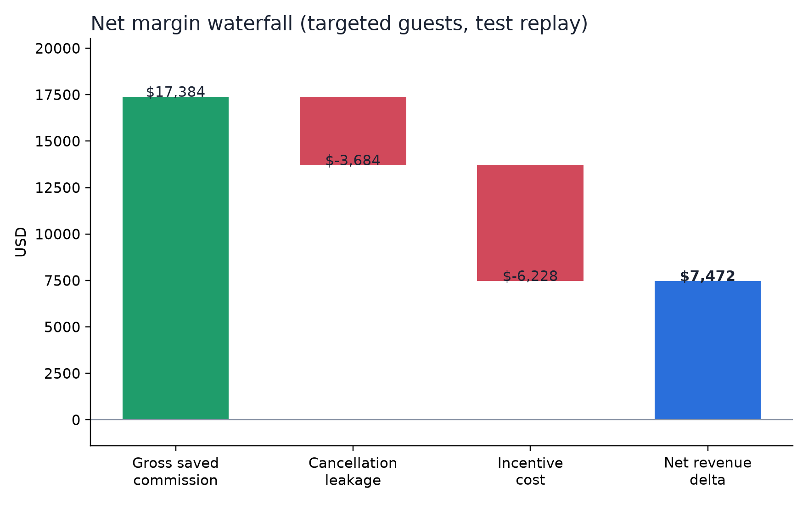

### Uplift ranking quality

| Decile (pred. tau low→high) | 0 | 1 | 2 | 3 | 4 | 5 | 6 | 7 | 8 | 9 |
|---|---|---|---|---|---|---|---|---|---|---|
| Predicted tau | -0.17 | -0.02 | 0.05 | 0.10 | 0.14 | 0.17 | 0.20 | 0.24 | 0.28 | 0.37 |
| True tau (oracle) | 0.10 | 0.12 | 0.13 | 0.14 | 0.14 | 0.15 | 0.16 | 0.16 | 0.16 | 0.17 |
| Measured lift (treated − holdout) | 0.10 | 0.11 | 0.09 | 0.20 | 0.01 | 0.11 | 0.08 | 0.19 | 0.12 | 0.19 |

Honest reading: the model's ranking beats random (Qini>0, Spearman 0.37 between predicted and measured decile lift) but is **noisy and over-dispersed** — it predicts negative tau for the bottom decile where the true effect is positive, and each decile has only ~90 control guests, so measured lift is itself noisy. Treat the targeting as modest.

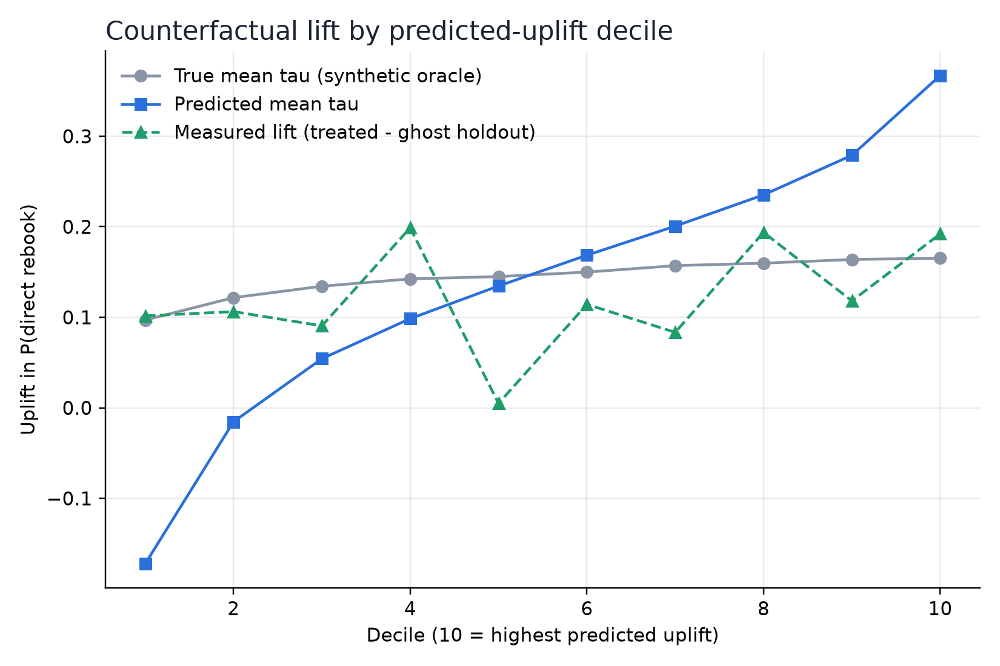

### Latency: CPU vs GPU

| Operation | CPU | CUDA (RTX 3090) |
|---|---|---|
| X-learner training (20k rows) | 0.38 s | 1.05 s |
| T-learner / cancel training (CUDA) | - | 0.70 s / 0.35 s |
| Uplift inference, 1 row | 2.3 ms | 3.4 ms |
| Uplift inference, 5 000 rows | 4.7 ms | 5.7 ms |
| Identity resolution, 20 000 bookings | - | 1.11 s total (embed 0.29, FAISS-CPU block 0.22, CUDA cosine 0.18, rerank 0.41) |
| Peak VRAM | - | 1.6 GB of 24 GB |

The GPU is **slower** here: the data is too small to amortise transfer/launch overhead. The CUDA path is real and wired (`device=cuda`, torch tensors) and is expected to pay off only at far larger data/model sizes.

### Pipeline & quality

| Item | Value |
|---|---|
| Full `verify_e2e.py` run | ≈ 4 min (train+gates 6.5 s, replay 0.9 s, diagrams 0.5 s, VLM audit 24 s, pytest 6 s, screenshots ≈ 175 s) |
| Tests | 40 passed (data gates, 6 node validators, guardrails, graph, LLM retry/fallback, 5 flows) |
| VLM chart audit (live `qwen3-vl-30b-a3b-instruct`) | 6 charts, mean quality 9.0/10. Treat as advisory: it scored two diagrams 9 before manual review found overlapping text, which was then fixed |

---

## Five end-to-end flows

Five real bookings are selected by `agent/scenarios.py` and available in the Streamlit **End-to-End Flows** tab, the Flask simulator (`GET /api/scenarios`) and `tests/test_scenarios.py`.

| # | Flow | Guest / booking | Resolution | tau / P(cancel) | Proposed → final | Dispatch |
|---|---|---|---|---|---|---|
| 1 | **Happy path** (pre-arrival) | Mei, Expedia, 4 nights ADR $164, SC $133 | fuzzy name+phone4 → `P000104` | +0.214 / 0.03 | ROOM_UPGRADE → ROOM_UPGRADE (ENRD $16.26, margin 55%) | **sent** |
| 2 | **Rate-parity breach** (pre-arrival) | Lisa, Agoda, 5 nights, SC $159; hotel direct rate set 10% below OTA | fuzzy → `P004497` | +0.400 / 0.10 | 3 proposals all blocked by **R1** → 2 retries → **NO_OFFER** | `no_action` |
| 3 | **Ghost holdout** (pre-arrival) | Lisa, Booking.com, 7 nights, SC $263 | deterministic e-mail → `P003328` | +0.350 / 0.10 | ROOM_UPGRADE → **LATE_CHECKOUT** (CRS: no upgrade inventory), ENRD $68 | `suppressed_ghost_holdout` |
| 4 | **New guest on Wi-Fi** (on-property) | Ashley, Agoda, 2 nights, SC $47 | unmatched → `SHADOW-B0000000` | +0.240 / 0.09 | WIFI_LOYALTY_JOIN → same (ENRD $6.88) | **sent** via portal |
| 5 | **Post-stay win-back** | Steven, Expedia, 3 nights, SC $97 | fuzzy → `P003854` | +0.388 / 0.09 | WINBACK_POINTS → same (ENRD $22.46) | **sent** |

With the live LLM the *offer* in flows 1 and 3 can vary between runs (breakfast / upgrade / late checkout); the dispatch outcomes do not. Tests run with the LLM offline.

Per-stage content shown for every flow:

| Stage | Panel contents |
|---|---|
| 1 `ingest_and_resolve` | webhook, identity method + confidence, CDP profile (tier, consent, fatigue) or shadow profile, saved commission, gates |
| 2 `score_guest` | tau, P(cancel), device + latency, feature vector, gates |
| 3 `select_strategy` | proposed offer, channel, LLM mode/attempts, rationale, personalised copy, rejected offers, gates |
| 4 `apply_guardrails` | verdict, retries, ENRD, margin, R1–R6 PASS/BLOCK table, downgrade reason, gates |
| 5 `compose_and_dispatch` | final copy, signed link, dispatch status, CRS inventory, "final offer differs from LLM proposal" note, gates |
| 6 `log_and_attribute` | attribution record (treatment vs holdout), gates |

All screenshots: `outputs/screenshots/e2e_flows/` (Streamlit `streamlit_flow_<n>_*.png`, Flask `flask_flow_<n>_*.png`).

---

## The Streamlit end-to-end story

Run `python -m streamlit run ui_streamlit/dashboard.py --server.port 8511` and open the **End-to-End Flows** tab. The header always shows the live LLM, the GPU, and whether models were promoted. Here is a walk-through of one operations session.

### Chapter 1 — A normal guest becomes a direct-booking lead

Mei booked 4 nights through Expedia and the hotel pays a 20% commission ($133). The agent resolves her to CDP profile `P000104` from name + phone-last-4, scores her at **tau = +0.21** with only a 3% chance of cancelling, and asks the local VLM for an offer. The proposal passes all six rules (ENRD +$16, margin 55%), a signed member link is built and the message is **sent**. All six stage cards are green and every gate passes.

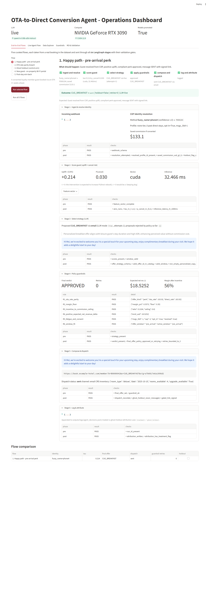

### Chapter 2 — The hotel undercuts the OTA; the agent refuses to act

Lisa has a high tau (+0.40) and the hotel would love the booking — but the hotel's own web rate is 10% below Expedia/Agoda's. Any incentive here risks OTA rate-parity penalties. **R1** blocks the first proposal; the loop returns to Stage 3 twice (the `×3` badge on *select strategy* and *apply guardrails*), the LLM tries breakfast, upgrade and late checkout, all blocked. After the retry cap the agent settles on **NO_OFFER** and sends nothing. The audit trail (`guardrail_audits.jsonl`) records each block and the reason.

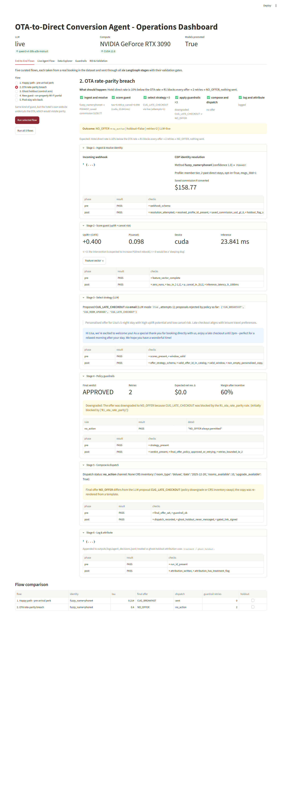

### Chapter 3 — The control group stays silent

This guest is resolved by an exact e-mail match and would clearly qualify (tau +0.35, ENRD $68). But she was randomly assigned to the 15% ghost holdout. The policy approves the offer, yet Stage 5 records `suppressed_ghost_holdout` and the post-condition gate asserts the message was never sent. Stage 5 also shows the CRS swap: the LLM proposed a room upgrade, inventory had none, so the offer became a late checkout and the copy was re-rendered — the yellow note makes that visible instead of leaving a stale rationale.

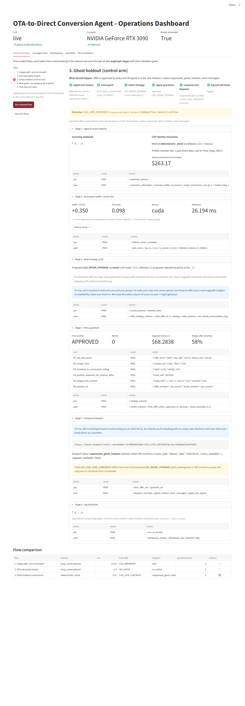

### Chapter 4 — A stranger on the hotel Wi-Fi

Ashley matches nobody in the CDP, so the agent creates a `SHADOW-…` profile with unknown consent. Pre-arrival e-mail would breach the consent rule (R5), but the on-property **Wi-Fi portal** captures opt-in, so a loyalty-join offer is allowed and **sent** through the portal.

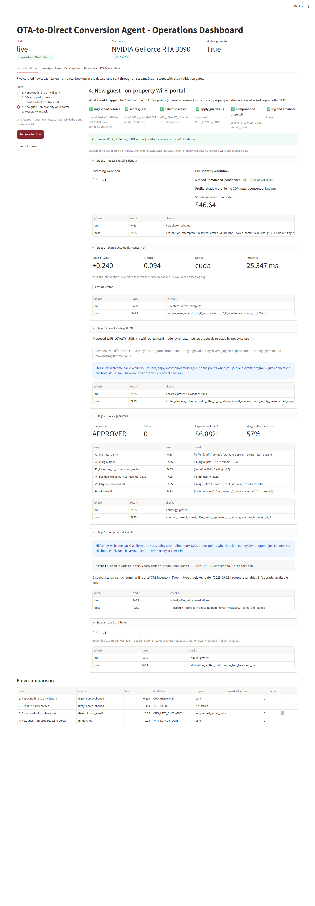

### Chapter 5 — After checkout: win-back

Steven has checked out. With $97 of commission at stake and tau +0.39, a points-based win-back (cost within the 60% ceiling) is approved and sent.

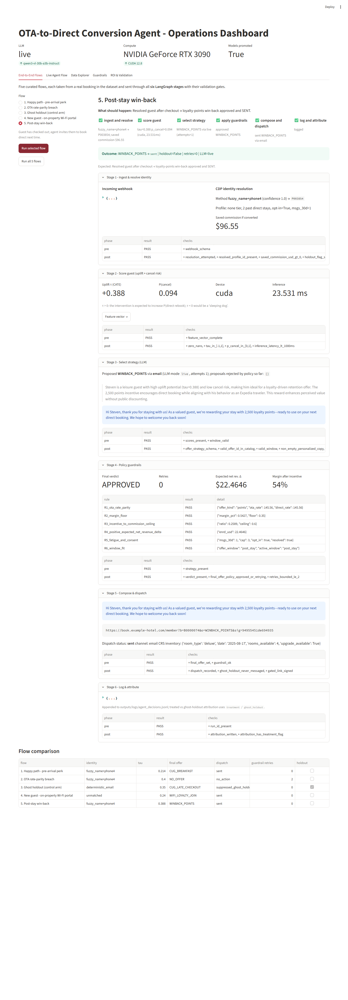

### Chapter 6 — Comparing the five

*Run all 5 flows* fills the comparison table (identity method, tau, final offer, dispatch, retries, holdout): three messages sent, one blocked by policy, one suppressed for measurement.

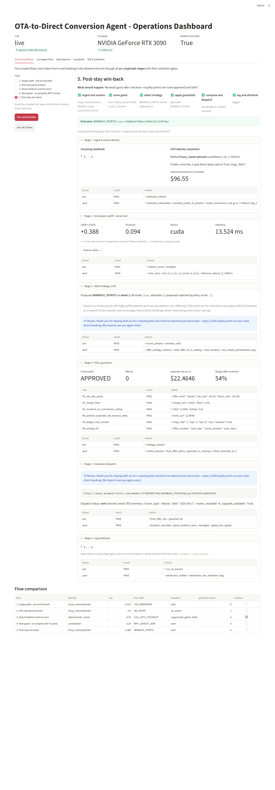

### Chapter 7 — Governance and ROI

The **Guardrails** tab lists the rules, the offer catalog and recent blocked proposals; **ROI & Validation** shows the three gates, replay lift/ROI and every chart with its VLM audit.

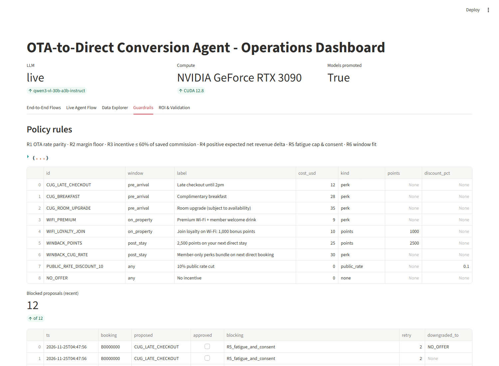
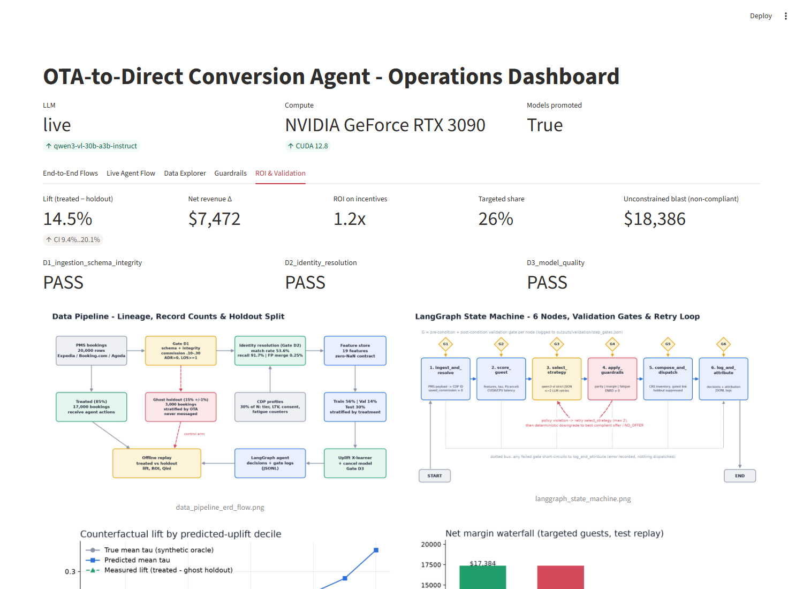

The other tabs: **Live Agent Flow** (free-form booking row + scenario selector) and **Data Explorer** (bookings, holdout share, identity-method breakdown).

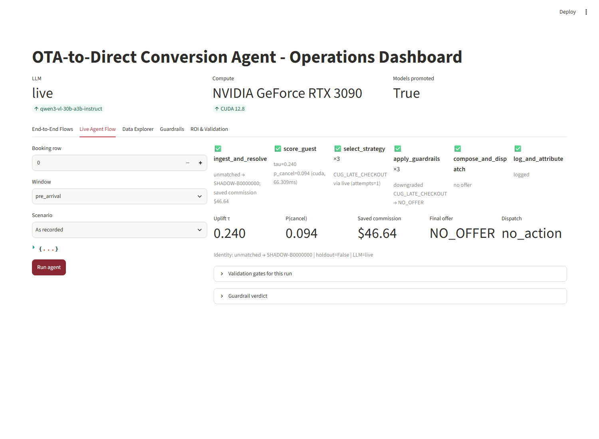

The same flows run in the Flask simulator (buttons under *End-to-end sample flows*):

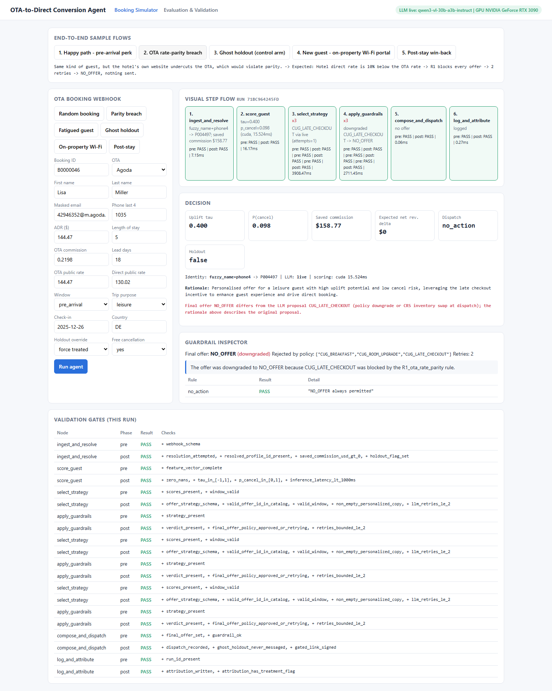

---

## Presentation deck

`presentation/OTA_to_Direct_Agent_Deck.pptx` (31 slides): executive summary, architecture and the 10-step approach, one slide per agent stage (what it does, gate, metrics, Streamlit panel), overall and per-stage metrics (gates, calibration, uplift ranking, node latency, CPU vs GPU), the five end-to-end flows with Streamlit screenshots, caveats and next steps.

```powershell
python presentation/capture_flows.py     # 2x Streamlit captures of the five flows (narrow viewport for legibility)
python presentation/prepare_assets.py    # crops per-stage panels
cd presentation; npm install; node build_deck.js   # reads outputs/* so every number is current
```

## Results & caveats

* All three gates pass; models promoted (T-learner). An earlier run **blocked promotion at AUC 0.672**; I strengthened the synthetic cancel signal rather than lower the threshold.
* The consent rule (R5) matters: excluding unmatched guests from pre-arrival incentives cut the targeted share from 63% to 26% and net revenue delta from ≈ $15k to ≈ $7.5k. Relax per market if legally appropriate.
* The "blast everyone" baseline ($18.4k) ignores consent and guardrails and is **not** a compliant comparison; it shows what compliance costs on this generator.
* Uplift ranking is modest (see decile table). The cheap perk dominates the offer mix because the generator makes most guests responsive.
* Identity recall is 91.7% on synthetic noise (typos, nicknames, masked e-mail); real CDPs will differ.
* GPU gives no speed-up at this scale; FAISS runs on CPU in this environment.

## REST API (Flask)

| Route | Purpose |
|---|---|
| `GET /api/health` | LLM endpoint, GPU, model promotion |
| `GET /api/sample?window=` | a realistic webhook from the dataset |
| `GET /api/scenarios` | the five curated flows (webhook + expected outcome) |
| `POST /api/simulate` | run the 6-node agent -> trace, gates, scores, guardrail verdict, dispatch |
| `GET /api/audit/decisions`, `/api/audit/guardrails` | recent JSONL records |
| `GET /api/validation`, `/api/metrics`, `/api/evaluation`, `/api/charts` | reports |

```powershell
curl -s localhost:5055/api/scenarios            # pick a webhook, then:
curl -s -X POST -H "Content-Type: application/json" -d @webhook.json localhost:5055/api/simulate
```

## Layout

```
config/       settings.py (LLM discovery, CUDA), offer_catalog.yaml
data/         synthetic_generator.py, schema_validator.py (Gate D1)
models/       identity_resolution.py (D2), uplift_pipeline.py, train_and_evaluate.py (D3)
agent/        state.py, validators.py, tools.py, policy_engine.py, llm_client.py, graph.py, scenarios.py
web_flask/    app.py, templates/{index,evaluation}.html, static/style.css
ui_streamlit/ dashboard.py, flow_view.py
evaluation/   diagram_generator.py, offline_replay.py, vlm_chart_auditor.py, verify_e2e.py
tests/        test_step_validators.py, test_guardrails_and_graph.py, test_scenarios.py
outputs/      models/ validation/ evaluation/ metrics/ logs/ charts/ screenshots/ (+ e2e_flows/)
```

Offers, costs, margin floor, incentive ceiling and fatigue cap live in `config/offer_catalog.yaml`; change them without touching code.
