# Hospitality Marketing RAG

Hybrid (dense + BM25 + RRF + cross-encoder) RAG over synthetic hospitality case studies, KPI sheets, campaign
reports and brand guidelines, grounded by a local **Qwen3-Coder-30B-A3B-Instruct** (OpenAI-compatible endpoint,
e.g. LM Studio at `http://localhost:1234/v1`). Every answer carries `[source | page | period]` citations and is
checked by a built-in **faithfulness verifier** (numeric matcher + citation check + LLM judge).

**Contents**
1. [Highlights](#1-highlights)
2. [Architecture overview](#2-architecture-overview)
3. [The 9-stage pipeline](#3-the-9-stage-pipeline)
4. [Detailed flow, stage by stage](#4-detailed-flow-stage-by-stage)
5. [Data model](#5-data-model)
6. [Metrics](#6-metrics)
7. [Setup](#7-setup)
8. [Run](#8-run)
9. [API reference](#9-api-reference)
10. [Streamlit UI](#10-streamlit-ui)
11. [Configuration](#11-configuration)
12. [Testing](#12-testing)
13. [Project layout](#13-project-layout)
14. [Design notes](#14-design-notes)
15. [Outputs](#15-outputs)
16. [Known limitations](#16-known-limitations)

---

## 1. Highlights

| Capability | How it is done |
|---|---|
| Table-aware chunking | Tables are never split; each row is also linearized into a sentence |
| Hybrid retrieval | ChromaDB dense vectors + BM25Okapi, fused with Reciprocal Rank Fusion (RRF) |
| Precision reranking | `BAAI/bge-reranker-large` cross-encoder, top-25 to top-5 |
| Metadata filtering | `property`, `period`, `channel`, `segment`, `doc_type`, enforced in three layers |
| Grounded generation | Local Qwen3-Coder, temperature 0, mandatory citations, refuses when evidence is missing |
| Hallucination guard | Regex number matcher + citation validator + LLM judge, giving a 0..1 faithfulness score |
| Observability | JSON artifact per stage, per-stage latency, logs, charts, audit screenshots |
| Interfaces | FastAPI service plus a Streamlit UI |

---

## 2. Architecture overview

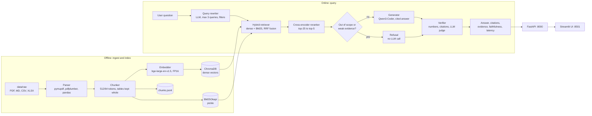

Two external runtimes are involved: the **GPU** (embedder + reranker, loaded lazily) and the **LLM server**
(LM Studio, used for rewrite, answer and judge calls).

---

## 3. The 9-stage pipeline

Orchestrated by `RAGPipeline` in `src/pipeline.py`. Each stage writes an artifact to `outputs/stage_artifacts/`.

| # | Stage | Module | Artifact |
|---|-------|--------|----------|
| 1 | Ingest PDF / MD / CSV / XLSX (pymupdf + pdfplumber + pandas) | `src/ingest/parser.py` | |
| 2 | Chunk (512/64 tokens), **tables never split**, row linearization, 8-field Pydantic metadata | `src/ingest/chunker.py` | `01_chunks.json` |
| 3 | Embed on GPU (`BAAI/bge-large-en-v1.5`, FP16) | `src/indexing/embedder.py` | |
| 4 | Dual index: persistent ChromaDB + pickled BM25Okapi, both honouring metadata filters | `src/indexing/vector_sparse_store.py` | |
| 5 | Query rewrite: <=3 queries, acronym expansion, filter extraction | `src/retrieval/query_rewriter.py` | `02_rewritten_query.json` |
| 6 | Hybrid retrieve + Reciprocal Rank Fusion | `src/retrieval/hybrid_retriever.py` | `03_rrf_candidates.json` |
| 7 | Rerank top-25 -> top-5 (`BAAI/bge-reranker-large`, FP16) | `src/retrieval/reranker.py` | `04_reranked_top5.json` |
| 8 | Grounded answer with `[source \| page \| period]` citations | `src/generation/generator.py` | |
| 9 | Verify: numeric claim matcher + citation check + LLM judge -> faithfulness 0..1 | `src/generation/verifier.py` | `05_answer_verification.json` |

Stages 1 to 4 run once (offline, `ingest()`); stages 5 to 9 run per question (`query()`).

### Sequence of one query

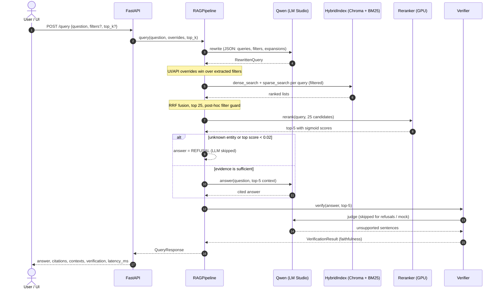

---

## 4. Detailed flow, stage by stage

### 4.1 Ingest and parse (`src/ingest/parser.py`, `data_generator.py`)
- If `data/raw` is empty (or `regenerate=True`) a deterministic synthetic corpus is generated (seed `42`):
  property case studies, KPI tables (ADR, RevPAR, occupancy by channel and quarter), campaign reports and brand
  guidelines.
- Files are parsed into `ParsedElement`s: text blocks and tables, each tagged with source and page.

### 4.2 Chunking (`src/ingest/chunker.py`)

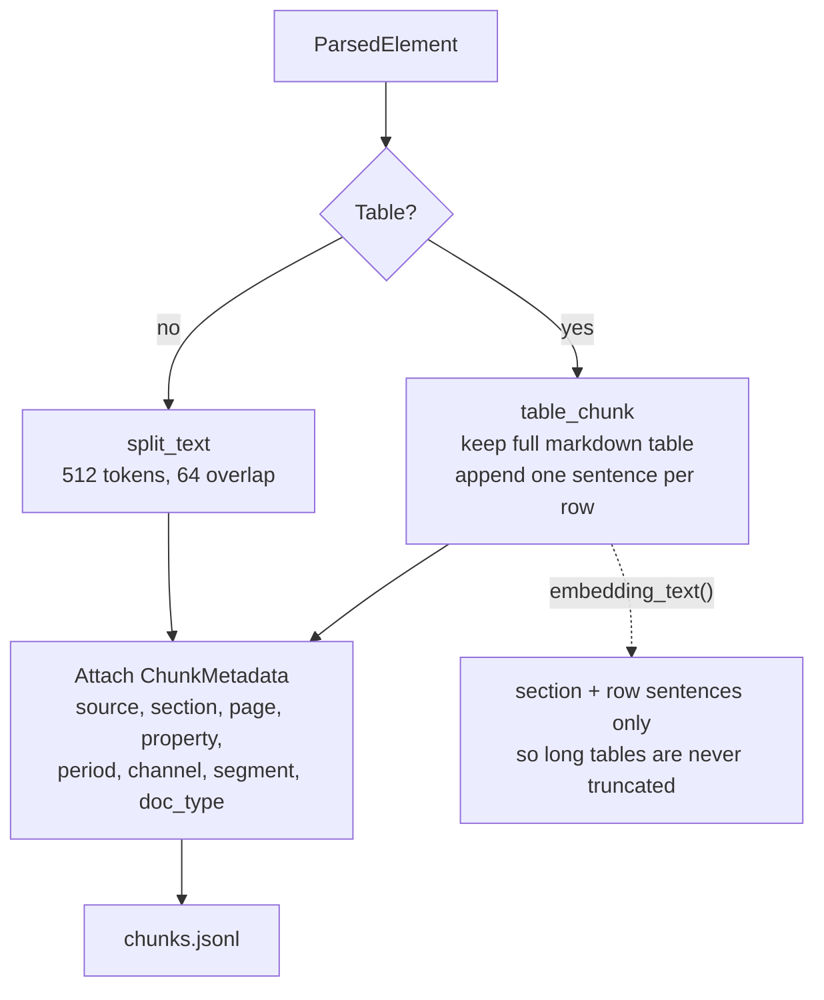

- **Row linearization**, e.g. `Miami Beach Resort: Q3 2025, Direct channel, ADR (Average Daily Rate) $182,
  Occupancy 74%, ...`. This lets both BM25 and the dense model match a specific metric.
- The chunk `text` is the whole table plus the row sentences; the **embedding text** is only section + row
  sentences. The untouched table is kept in `table_md` for display.
- Metadata is validated by Pydantic (non-empty; use `all` / `unknown` when a field does not apply).

### 4.3 Embedding and dual indexing (`src/indexing/`)
- `bge-large-en-v1.5` in FP16 on CUDA, batch size 32. Loaded lazily; VRAM usage is logged.
- **ChromaDB** persistent collection `hospitality_marketing` (dense, metadata `where` filters).
- **BM25Okapi** pickled to `data/processed/bm25_index.pkl` (sparse, filters applied by masking).
- `HybridIndex.vocab` exposes the known properties, periods and channels used by the rewriter and the scope guard.

### 4.4 Query rewrite (`src/retrieval/query_rewriter.py`)
- One LLM call returns JSON: up to **3** standalone search queries, extracted filters and acronym expansions
  (`ADR` becomes *average daily rate*).
- Filters are validated against the index vocabulary so the LLM cannot invent a property or period.
- Explicit overrides from the UI/API are merged on top and win over extracted filters.

### 4.5 Hybrid retrieval and RRF (`src/retrieval/hybrid_retriever.py`)

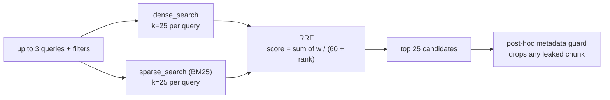

- Every query is searched by both retrievers, giving up to 6 ranked lists, fused by
  `score(d) = Σ weight / (rrf_k + rank)` with `rrf_k = 60` and equal weights.
- Filters are enforced in **three layers**: Chroma `where`, BM25 masking, and the post-hoc `matches()` guard.
  `period`/`property`/`doc_type` are exact matches; `channel`/`segment` also match chunks tagged `all`.

### 4.6 Cross-encoder rerank (`src/retrieval/reranker.py`)
- `bge-reranker-large` scores (query, chunk) pairs (sigmoid output, batch 16) and keeps the top **5**
  (`top_k` can override 1 to 10 via the API).
- Scores separate relevant tables from filler quickly, e.g. `0.999, 0.999, 0.987, 0.780, 0.011`.

### 4.7 Scope gate and generation (`src/generation/generator.py`)

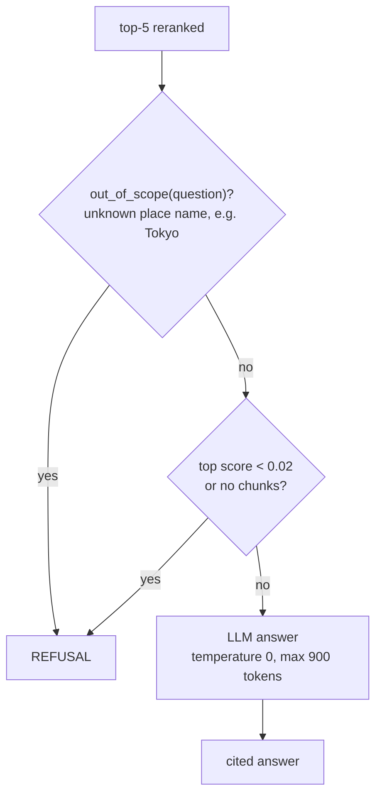

- Refusals short-circuit **before** the LLM is called (about 5 s instead of about 25 s).
- The prompt requires each fact to cite `[source | page | period]`, forbids computing new numbers
  (differences, sums), and instructs refusal when context is insufficient.

### 4.8 Verification (`src/generation/verifier.py`)

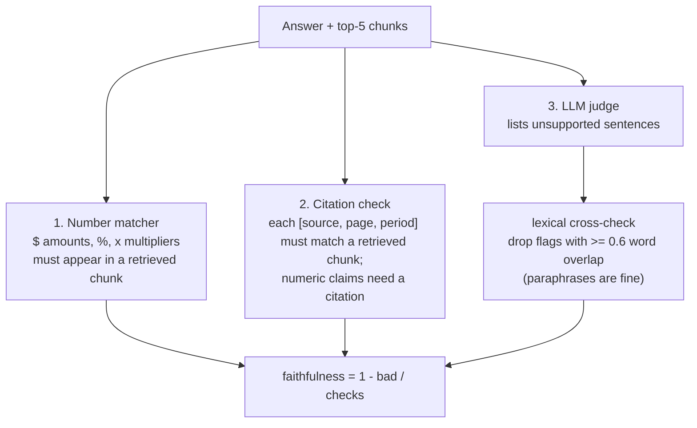

- **Checks (denominator)** = every numeric claim + every non-numeric answer sentence + every citation error
  (+ one unit for a judge flag on a sentence already counted through its numbers).
- **Bad (numerator)** = unsupported numbers + judge-flagged sentences + citation errors.
- Examples: one judge flag among four narrative bullets costs `0.25` (score `0.75`); a fabricated `$299` among
  two numbers drops the score to `0.50`.
- Years, quarters and page ids are ignored by the number extractor. Refusals skip the judge.

### 4.9 Response assembly
`QueryResponse` bundles the answer, de-duplicated citations, the top-5 contexts, the `VerificationResult` and
`latency_ms` for `rewrite`, `retrieve`, `rerank`, `generate`, `verify` and `total`. CUDA cache is released after
each query.

---

## 5. Data model

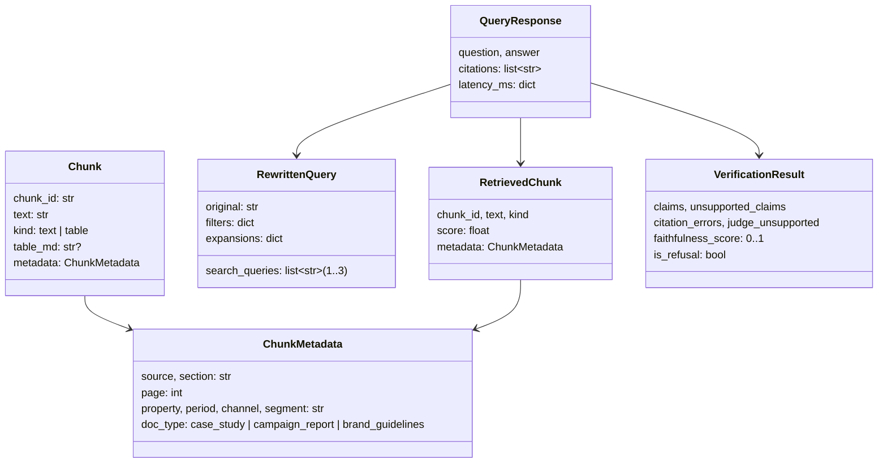

Defined in `src/schemas.py`.

---

## 6. Metrics

All numbers below come from the latest live run (Qwen3-Coder-30B-A3B via LM Studio, GPU embedder/reranker) and
are stored in `outputs/metrics/`. Regenerate them with `python scripts/run_end_to_end.py`.

### 6.1 Retrieval quality (12 golden questions, `tests/golden_qa.json`)

| System | Hit@5 | MRR@5 | nDCG@5 |
|---|---:|---:|---:|
| BM25 only | 1.000 | 0.621 | 0.701 |
| Dense only | 1.000 | 0.958 | 0.890 |
| **RRF hybrid** | **1.000** | **1.000** | **1.000** |
| RRF + cross-encoder rerank | 1.000 | 1.000 | 1.000 |

Hybrid fusion lifts MRR from 0.62 (BM25) and 0.96 (dense) to 1.00. The golden set is small, so reranking cannot
show an additional gain here (see [limitations](#16-known-limitations)).

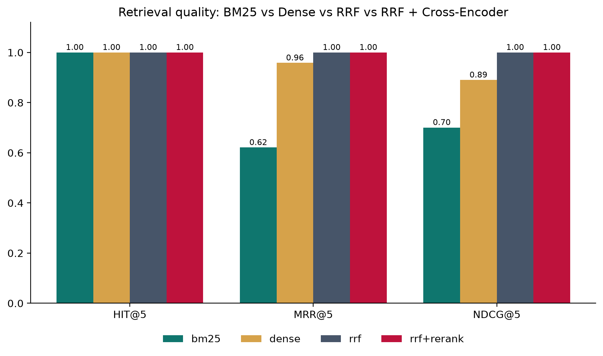

### 6.2 Answer faithfulness (6 benchmark questions)

| Question | Faithfulness | Refused |
|---|---:|:---:|
| ADR, Direct channel, Miami Beach Resort, Q3 2025 | 0.83 | no |
| RevPAR and occupancy by channel, Orlando Grand Hotel, only Q3 2025 | 1.00 | no |
| OTA vs Direct ADR, Fort Lauderdale Marina Inn, Q1 2025 | 1.00 | no |
| ROI of the summer direct booking campaign, Miami Beach Resort | 0.75 | no |
| How CRM uses LTV to target loyalty members | 1.00 | no |
| Q3 2025 ADR in Tokyo (out of scope) | 1.00 | **yes** |
| **Mean** | **0.931** | |

Every score below 1.00 in this run was a single LLM-judge flag, with no unsupported number and no citation error.

### 6.3 Latency per stage (ms, live LLM)

| Question | Rewrite | Retrieve | Rerank | Generate | Verify | Total |
|---|---:|---:|---:|---:|---:|---:|
| Miami Direct ADR | 8,466 | 77 | 4,220* | 16,198 | 5,252 | 34,213 |
| Orlando RevPAR by channel | 6,674 | 67 | 134 | 15,223 | 1,778 | 23,875 |
| Fort Lauderdale OTA vs Direct | 7,320 | 69 | 134 | 18,112 | 983 | 26,619 |
| Miami summer campaign ROI | 4,464 | 66 | 320 | 14,537 | 4,419 | 23,806 |
| CRM and LTV (narrative) | 4,191 | 69 | 354 | 10,798 | 1,338 | 16,748 |
| Tokyo (refused) | 5,220 | 70 | 190 | 0.3 | 0.5 | 5,480 |
| **Mean** | **6,056** | **70** | **892** | **12,478** | **2,295** | **21,790** |

\* The first query includes loading the reranker onto the GPU; steady-state rerank is about 130 to 350 ms.

Takeaways: retrieval plus rerank is roughly **0.2 to 0.4 s**; the three LLM calls (rewrite, generate, judge) make
up more than **95%** of the total, so latency is governed by the LLM, not the search. Refusals are ~4x faster
because the answer LLM is skipped.

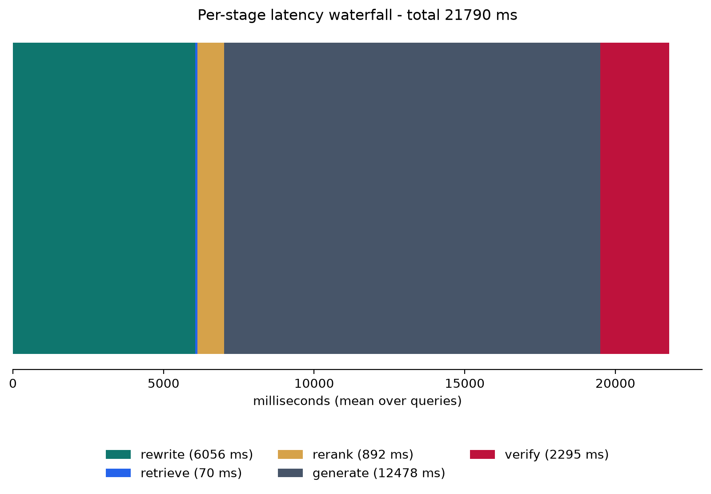

### 6.4 Indexing

| Metric | Value |
|---|---:|
| Chunks | 58 (24 table chunks, 34 text chunks) |
| Synthetic data generation | 0.14 s |
| Parse + chunk | 1.49 s |
| Embed + index (GPU) | 7.37 s |
| VRAM, embedder | ~0.7 GB |
| VRAM, reranker | ~1.1 GB (about 3.3 GB reserved together) |

### 6.5 Tests

| Metric | Value |
|---|---:|
| Tests collected | 19 |
| Passed | 18 |
| Skipped | 1 (`test_live_qwen_answer_is_faithful`, needs `--live-llm`) |
| Duration | ~20.7 s |

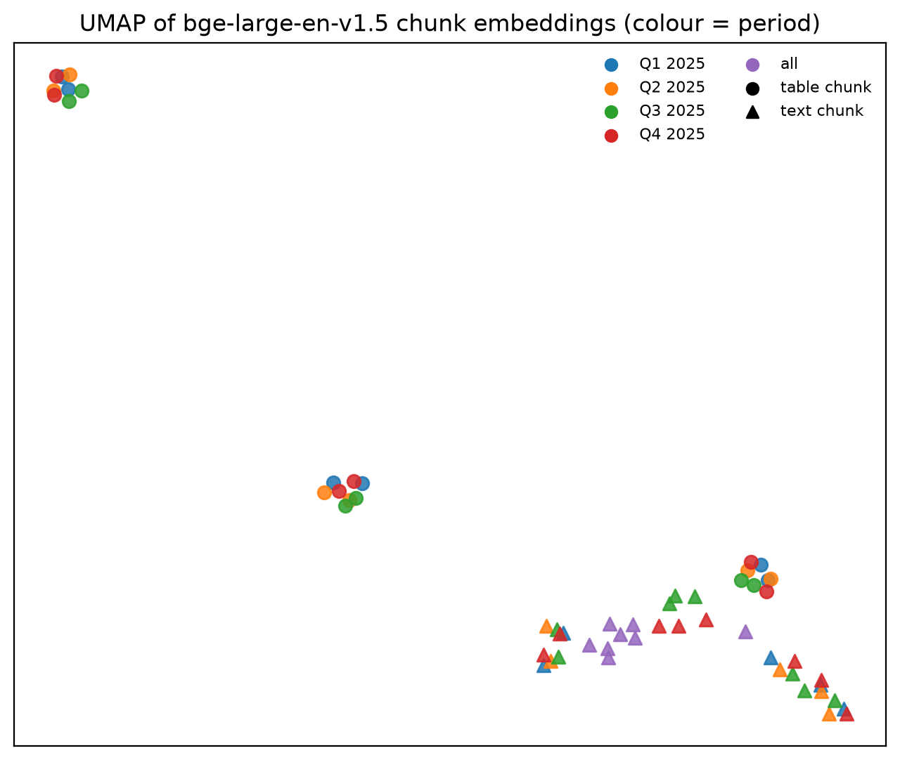

---

## 7. Setup

Windows, Python 3.11, CUDA GPU.

```powershell
conda activate rag-agent-gpu            # created by ../setup.ps1
pip install torch --index-url https://download.pytorch.org/whl/cu128
pip install -r requirements.txt
```

Load `qwen3-coder-30b-a3b-instruct` in LM Studio and start its server (port 1234). Endpoint and model are in
`configs/config.yaml` (`llm.*`). Set `llm.mode: mock` (or `RAG_LLM_MODE=mock`) to run without the LLM.

---

## 8. Run

```powershell
python scripts/run_end_to_end.py          # data -> index -> queries -> metrics/charts -> pytest -> screenshots
python scripts/run_end_to_end.py --mock   # same, deterministic mock LLM
pytest                                    # fast suite (mock LLM; GPU models are real)
pytest --live-llm                         # also exercise the real Qwen endpoint
uvicorn api.main:app --port 8000          # /health /ingest /query /verify  (docs at /docs)
```

Minimal programmatic use:

```python
from src.pipeline import RAGPipeline

p = RAGPipeline()
p.ingest()                     # first time only; later: p.load_index()
r = p.query("What was the ADR for the Direct channel at Miami Beach Resort in Q3 2025?")
print(r.answer, r.citations, r.verification.faithfulness_score, r.latency_ms)
```

**Guided tour with screenshots: [docs/WALKTHROUGH.md](docs/WALKTHROUGH.md)**

---

## 9. API reference

FastAPI app in `api/main.py`; interactive docs at <http://localhost:8000/docs>.

| Endpoint | Purpose |
|---|---|
| `GET /health` | API state, chunk count, LLM mode, CUDA |
| `POST /ingest` | Rebuild the index |
| `POST /query` | Full pipeline: answer, citations, evidence, verification, latency |
| `POST /verify` | Verify any answer text against given chunk ids |
| `GET /meta/filters` | Filter options for dropdowns |
| `GET /meta/examples` | Curated sample questions |
| `GET /meta/metrics` | Latest retrieval, latency and test metrics |
| `GET /chunks/{chunk_id}` | Full text and source table of one chunk (404 if unknown) |

`POST /query` accepts optional `filters` (keys: `property`, `period`, `channel`, `segment`, `doc_type`) that win
over extracted filters, and `top_k` (1 to 10). Unknown filter keys or an out-of-range `top_k` return `422`.

```bash
curl -X POST http://localhost:8000/query -H "Content-Type: application/json" -d '{
  "question": "Show RevPAR by channel",
  "filters": {"period": "Q3 2025", "property": "Orlando Grand Hotel"},
  "top_k": 3
}'
```

Response shape: `question`, `rewritten`, `answer`, `citations`, `contexts[]`, `verification`, `latency_ms`.

---

## 10. Streamlit UI

```powershell
python scripts/run_ui.py                      # starts FastAPI (:8000) + Streamlit (:8501), warms the GPU models
python scripts/run_ui.py --mock               # without the Qwen server
python scripts/capture_ui_screenshots.py      # drives the real UI/Swagger with Chrome -> outputs/screenshots/ui_*.png, api_*.png
```

The UI is a thin client over the API (`ui/api_client.py`). Tabs: **Ask**, **Evidence**, **Pipeline**, **Metrics**,
**History**. Sidebar filters are sent as explicit overrides that win over filters extracted from the question.

| Ask | Evidence |
|---|---|
| 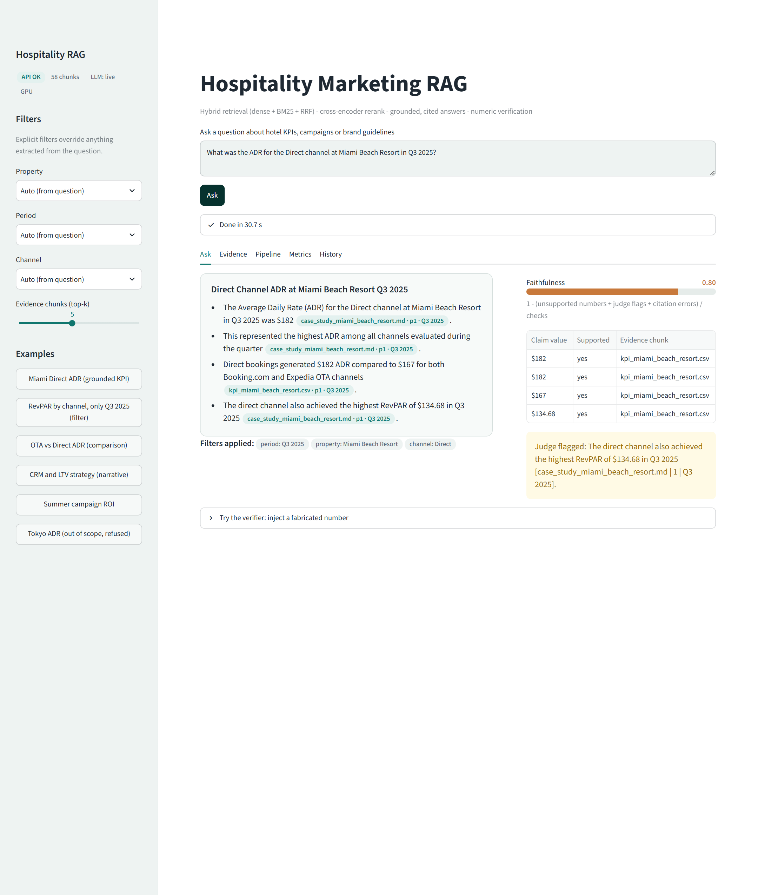 | 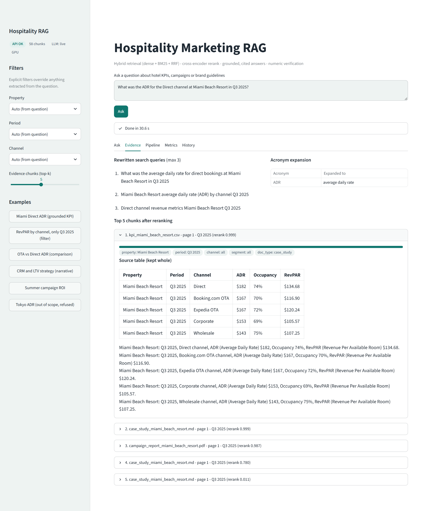 |

| Pipeline | Metrics |
|---|---|
| 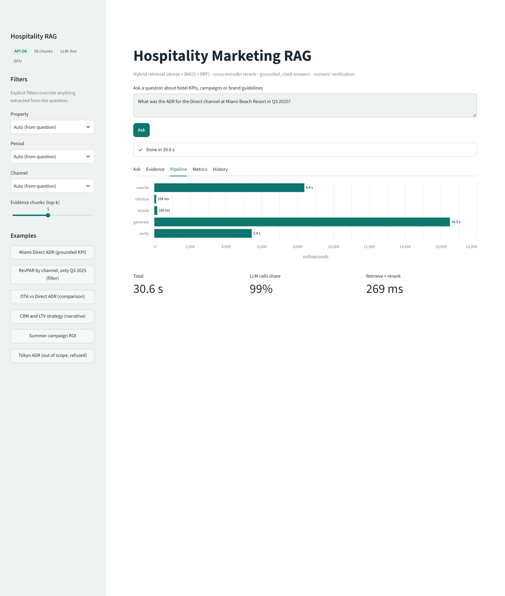 | 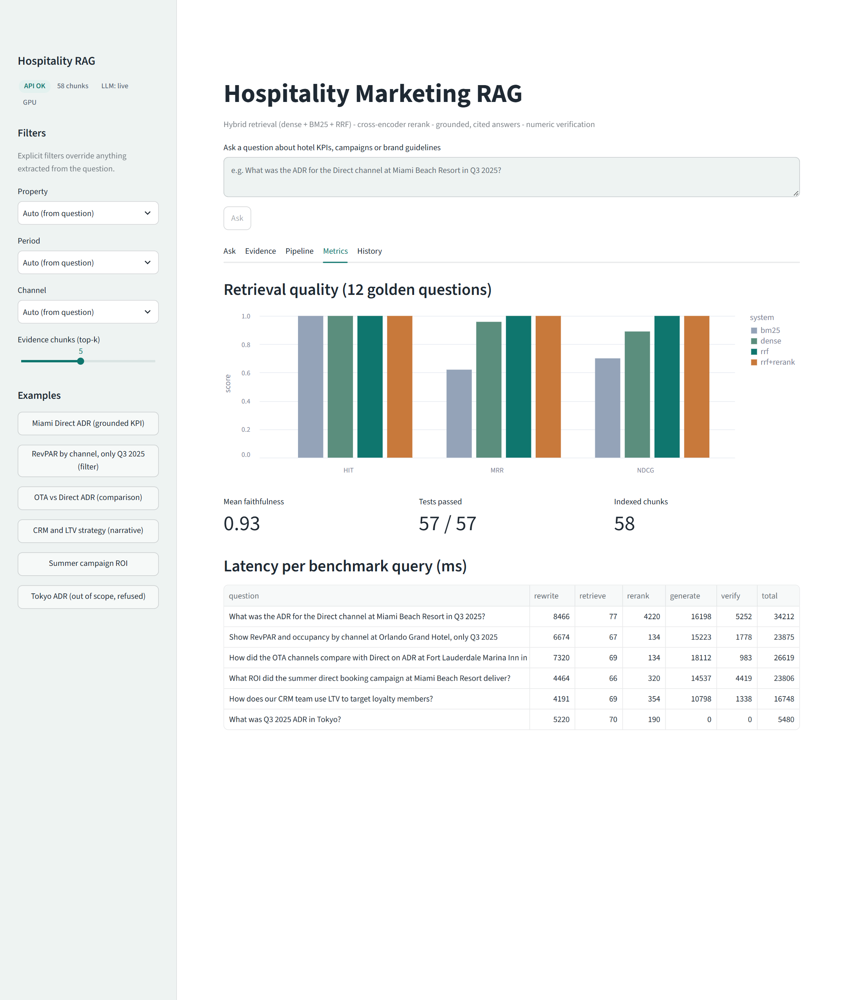 |

---

## 11. Configuration

`configs/config.yaml`

| Key | Default | Meaning |
|---|---|---|
| `llm.mode` | `live` | `live` or `mock` (deterministic, no server) |
| `llm.base_url` / `model` | `http://localhost:1234/v1` / `qwen3-coder-30b-a3b-instruct` | OpenAI-compatible endpoint |
| `llm.temperature` / `max_tokens` / `timeout` | `0.0` / `900` / `300` | Generation settings |
| `models.embedder` | `BAAI/bge-large-en-v1.5` | Dense embedder |
| `models.reranker` | `BAAI/bge-reranker-large` | Cross-encoder |
| `models.device` / `fp16` | `cuda` / `true` | Placement and precision |
| `chunking.chunk_tokens` / `overlap_tokens` | `512` / `64` | Text chunk size |
| `retrieval.dense_k` / `sparse_k` | `25` / `25` | Candidates per retriever per query |
| `retrieval.rrf_k` / `rrf_weights` | `60` / `{dense: 1.0, sparse: 1.0}` | Fusion |
| `retrieval.rerank_in` / `final_k` | `25` / `5` | Reranker input and output size |
| `retrieval.min_rerank_score` | `0.02` | Top chunk below this triggers refusal |
| `retrieval.max_queries` | `3` | Cap on rewritten queries |
| `seed` | `42` | Synthetic data seed |

---

## 12. Testing

| File | Covers |
|---|---|
| `tests/test_01_chunking_tables.py` | Tables kept whole, row linearization, metadata |
| `tests/test_02_query_rewrite.py` | Query cap, acronym expansion, filter extraction |
| `tests/test_03_hybrid_rerank.py` | RRF fusion, filter isolation (zero leakage), rerank |
| `tests/test_04_verification.py` | Fabricated numbers, citation errors, refusals, score formula, live Qwen (opt-in) |
| `tests/test_05_api_e2e.py` | End-to-end API behaviour |
| `tests/test_06_new_endpoints.py` | `/meta/*`, `/chunks/{id}`, filter overrides, validation |
| `tests/test_07_ui_smoke.py` | Streamlit app (examples, filter overrides, refusal, API down) |

The suite uses the mock LLM by default (real GPU models); `pytest --live-llm` adds the live Qwen test.

---

## 13. Project layout

```
hosiptality_marketing_rag/
├── api/                  FastAPI app (main.py) and example questions (examples.py)
├── ui/                   Streamlit app (app.py), API client, components
├── src/
│   ├── config.py         YAML loader / path resolver
│   ├── llm_client.py     OpenAI-compatible client with mock mode
│   ├── schemas.py        Pydantic models
│   ├── pipeline.py       RAGPipeline orchestrator
│   ├── ingest/           data_generator, parser, chunker
│   ├── indexing/         embedder, vector_sparse_store (Chroma + BM25)
│   ├── retrieval/        query_rewriter, hybrid_retriever, reranker
│   ├── generation/       generator, verifier
│   └── evaluation/       metrics, visualizer, screenshot_renderer
├── scripts/              run_end_to_end.py, run_ui.py, capture_ui_screenshots.py
├── tests/                pytest suite + golden_qa.json
├── configs/config.yaml
├── data/                 raw/ and processed/ (chunks.jsonl, bm25 pickle, chroma_db)
├── docs/WALKTHROUGH.md   Guided tour with screenshots
└── outputs/              logs, stage_artifacts, metrics, visualizations, screenshots
```

---

## 14. Design notes
- **Tables**: the chunk text is the full markdown table plus appended one-sentence-per-row summaries
  (`Miami Beach Resort: Q3 2025, Direct channel, ADR (Average Daily Rate) $182, Occupancy 74%, ...`). The dense
  embedder sees section + row sentences only, so long tables are never truncated mid-table for retrieval.
- **Filters**: `period`/`property`/`doc_type` are exact matches (`only Q3 2025` -> 0 chunks from other quarters,
  enforced in Chroma `where`, BM25 masking and a post-hoc guard). `channel`/`segment` also match chunks tagged
  `all` (multi-channel tables).
- **Refusals**: unknown place names (e.g. Tokyo), nonexistent periods, or weak rerank evidence short-circuit to a
  refusal without calling the LLM; the LLM prompt also instructs refusal.
- **Verifier**: numbers ($, %, x) must appear in the retrieved chunks; citations must reference a retrieved
  chunk; the LLM judge's flags are cross-checked by lexical overlap so paraphrases are not penalised. Derived
  numbers (differences/sums) are *not* accepted - the generator prompt forbids computing them.
  `faithfulness = 1 - bad / checks`, where checks are every numeric claim, every non-numeric answer sentence and
  every citation error (plus one unit for a judge flag on a sentence already counted through its numbers), so a
  single judge flag among four bullets costs 0.25 rather than zeroing the score.
- **VRAM**: embedder (~0.7 GB) + reranker (~1.1 GB) share the GPU with Qwen in LM Studio; models load lazily.

---

## 15. Outputs

`outputs/` (tracked in git):

| Folder | Contents |
|---|---|
| `logs/` | `pipeline_execution.log`, `api_server.log`, `ui_server.log` |
| `stage_artifacts/` | JSON per stage: `01_chunks`, `02_rewritten_query`, `03_rrf_candidates`, `04_reranked_top5`, `05_answer_verification` |
| `metrics/` | `retrieval_metrics.json`, `latency_breakdown.csv`, `test_report.json`, `coverage.json` |
| `visualizations/` | latency waterfall, retrieval comparison, embedding UMAP |
| `screenshots/` | 5 pipeline audit cards (`01`-`05`), 9 UI captures (`ui_*`), 6 API captures (`api_*`) |

---

## 16. Known limitations
- **LLM judge noise.** The judge sometimes flags valid comparisons ("highest RevPAR"). The lexical cross-check
  removes some, not all, of these.
- **Latency.** A live answer takes about 17 to 34 s because three LLM calls dominate. The first query after
  starting the API also loads the GPU models; `run_ui.py` warms them up.
- **Small synthetic corpus.** 58 chunks, 12 golden questions. Hybrid retrieval already scores 1.00 on the golden
  set, so reranking cannot show a gain over it here.
- **Model-computed numbers are rejected.** Differences or totals the LLM calculates on its own are not in the
  context, so they are flagged as unsupported by design.
- **Sentence-level checks rely on the judge.** Numbers are verified strictly by regex; non-numeric sentences are
  only as reliable as the judge model.
